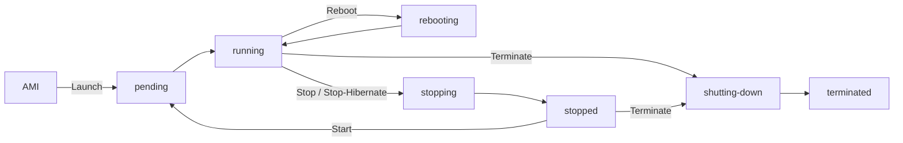

> [!abstract] Rövid összefoglaló
> Ez a jegyzet az **Amazon Web Services (AWS)** felhőplatform alapjait mutatja be, összekötve a hagyományos helyszíni (on-premises) IT-infrastruktúra és a Microsoft Azure fogalmaival. Áttekintjük a felhős árazási és költségkezelési modellt, a globális infrastruktúrát, a megosztott felelősségi modellt, valamint a jogosultságkezelés (**IAM**), a virtuális hálózatok (**VPC**) és a virtuális szerverek (**EC2**) működését és parancssori kezelését.

---

## 1. Az AWS alapjai és felügyeleti eszközei

> [!definition] Amazon Web Services (AWS)
> Az AWS egy biztonságos, globális felhőplatform, amely igény szerinti (**on-demand**) hozzáférést biztosít számítási kapacitáshoz, tárhelyhez, hálózati erőforrásokhoz, adatbázisokhoz és felügyeleti eszközökhöz. A szolgáltatások **építőkockákként** kapcsolódnak össze, és a felhasználó csak az adott pillanatban valóban használt erőforrásokért fizet.

Az AWS több mint 20 szolgáltatáskategóriát fed le (pl. *Compute, Storage, Database, Networking, Security, Analytics, Machine Learning, IoT, Developer Tools*). A legtöbb felhős elem közvetlenül megfeleltethető a klasszikus adatközponti eszközöknek:

### Hagyományos IT vs. AWS vs. Azure megfeleltetés

| Terület | Hagyományos (On-Premises) IT | AWS megfelelő | Microsoft Azure megfelelő |
| :--- | :--- | :--- | :--- |
| **Biztonság** | Tűzfalak, ACL-ek, rendszergazdák | Security Groups, Network ACLs, **IAM** | Azure NSG, **Microsoft Entra ID**, RBAC |
| **Hálózat** | Router, hálózati gerinc, switch | **Amazon VPC**, Elastic Load Balancing | **Azure VNet**, Azure Load Balancer |
| **Számítás** | Fizikai szerverek | **AMI** $\rightarrow$ **Amazon EC2** példányok | VM Image $\rightarrow$ **Azure Virtual Machines** |
| **Tárhely és DB** | DAS, SAN, NAS, RDBMS | **EBS**, **EFS**, **S3**, **Amazon RDS** | Managed Disks, Files, Blob, Azure SQL |
| **Webes felület** | Helyi menedzsment konzolok | **AWS Management Console** | **Azure Portal** |
| **Parancssor** | Helyi shell / SSH | **AWS CLI** | **Azure CLI / Az PowerShell** |
| **Automatizálás** | Helyi szkriptek | **AWS SDKs**, **CloudFormation** | **Azure SDKs**, **ARM / Bicep** |

> [!example] Tipikus egyszerű AWS-architektúra
> Egy webalkalmazásnál a felhasználók egy **Amazon VPC** virtuális hálózaton keresztül érik el az **Amazon EC2** szerveren futó alkalmazást, amely a strukturált adatokat **Amazon DynamoDB** adatbázisban, a statikus fájlokat (képek, dokumentumok) pedig **Amazon S3** tárhelyen tárolja.

### A 3 eléréi mód (Interakció az AWS-szel)
1. **AWS Management Console:** Grafikus webes felület (kezdéshez, vizualizációhoz ideális).
2. **AWS Command Line Interface (AWS CLI):** Parancssori eszköz egyedi parancsokhoz és szkriptelt automatizáláshoz.
3. **Software Development Kits (SDKs):** Programkódból (pl. Python, Java, PHP) történő közvetlen hozzáférés a szolgáltatásokhoz.

---

## 2. Árazási modell, költségkezelés és fiókszervezés

Az AWS költségeit három alapvető tényező (**fundamental drivers of cost**) határozza meg:

$$C_{osszes} = C_{szamitas} + C_{tarhely} + C_{kimeno\_adatforgalom}$$

* **Számítás (Compute):** Óra- vagy másodpercalapú elszámolás (*másodpercalapú számlázás Linux esetén*), a választott példánytípustól függően.
* **Tárhely (Storage):** Általában gigabájtonként ($GB$) történik a díjazás.
* **Adatforgalom (Data Transfer):** A **kimenő (outbound)** forgalmat összesítve, $GB$-onként számlázzák; a **bejövő (inbound)** forgalom jellemzően díjmentes (néhány kivételtől eltekintve).

### A 3 fizetési alapelv
1. **Pay for what you use (On-Demand):** Nincs előre lekötés, rugalmasan fizetsz a tényleges használatért.
2. **Pay less when you reserve (Reserved Instances – RI):** 1 vagy 3 éves elköteleződéssel **akár $75\%$ megtakarítás** érhető el. Három fizetési opció létezik:
   * **AURI** (*All Upfront RI*) $\rightarrow$ legnagyobb kedvezmény.
   * **PURI** (*Partial Upfront RI*) $\rightarrow$ közepes kedvezmény.
   * **NURI** (*No Upfront RI*) $\rightarrow$ kisebb kedvezmény.
3. **Pay less when you use more:** Sávos mennyiségi kedvezmények (*tiered pricing*) olyan tárhelyszolgáltatásoknál, mint az **S3, EBS, EFS** – minél több adatot tárolsz, annál kevesebbe kerül $1\text{ GB}$.

> [!done] 💡 Érthető magyarázat
> Az árazási modell olyan, mint a közlekedés: az **On-Demand** a taxizás (csak az útért fizetsz, de drágább a kilométerdíj), a **Reserved Instance** az éves bérlet (előre elköteleződsz, cserébe töredékáron utazol), a **sávos árazás** pedig a nagykereskedelmi mennyiségi kedvezmény.

### Díjmentes szolgáltatások és rejtett költségek

Az **AWS Free Tier** az új felhasználóknak 1 évig ingyenes keretet ad a tanuláshoz. Ezen felül önmagában **díjmentes** az **IAM**, a **VPC** alapfunkciója, a **CloudFormation**, az **Auto Scaling** és az **Elastic Beanstalk**.

> [!danger] Ingyenes keretrendszer != Ingyenes infrastruktúra!
> Az olyan keretszolgáltatások, mint a CloudFormation, az Auto Scaling vagy a VPC alapjai díjmentesek, **de az általuk létrehozott vagy hozzájuk kapcsolódó erőforrások** (EC2 példányok, NAT Gateway, nyilvános IPv4-címek, tárhely, kimenő adatforgalom) **díjkötelesek!** Az ingyenes keretek túllépése automatikusan számlázást generál.

### Szervezeti hierarchia és költségfelügyelet

> [!definition] AWS Organizations
> Központi fiókkezelő szolgáltatás, amely lehetővé teszi több AWS-fiók hierarchikus csoportosítását (**Root** $\rightarrow$ **Organizational Units / OUs** $\rightarrow$ **AWS Accounts**), szabályzatok (Policy) központi érvényesítését, API-alapú automatizálást és **összevont számlázást (Consolidated Billing)**.

| Funkció | AWS eszközök | Azure megfelelő |
| :--- | :--- | :--- |
| **Elszámolási egység** | AWS Account | Azure Subscription (közelítőleg) |
| **Hierarchia** | AWS Organizations / OUs | Management Groups |
| **Erőforrás-csoportosítás** | Resource Groups + **Tags** *(nem kötelező)* | Azure Resource Groups *(kötelező)* |
| **Költségelemzés** | **Cost Explorer**, **Cost and Usage Report (CUR)** | Cost analysis, Exports |
| **Költségkeret és riasztás** | **AWS Budgets**, Cost Anomaly Detection | Budgets, Cost alerts |
| **Optimalizálás** | Compute Optimizer, Cost Optimization Hub | Azure Advisor, Reservations / Savings Plan |

> [!danger] A Budget nem állítja le a szervereket!
> Az **AWS Budgets** és a költségriasztások **nem állítják le automatikusan** a futó szolgáltatásokat a keret elérésekor – csupán értesítést küldenek. Ha elfelejtesz leállítani egy erőforrást, a költségek tovább ketyegnek!

> [!warning] AWS Academy Sandbox korlátozások
> Az egyetemi laborokban használt **AWS Academy Sandbox** ideiglenes fiókokat biztosít. Ezekre **nem a személyes AWS Free Tier** szabályai vonatkoznak, valamint a laborjogosultságok korlátozhatják a választható régiókat (pl. gyakran csak `us-east-1`) és a költségkezelési funkciókat.

---

## 3. AWS Globális Infrastruktúra

Az AWS fizikai alapját három fő réteg alkotja: a **Régiók**, a **Rendelkezésre állási zónák** és a **Peremhelyszínek (Edge Locations)**.

> [!definition] AWS Region (Régió)
> Egy fizikailag elkülönített földrajzi terület (pl. London, Írország – `eu-west-1`), amely jellemzően **kettő vagy több Rendelkezésre állási zónából** áll. A régiók közötti adatreplikációt kizárólag az ügyfél szabályozza; a régiók az AWS saját nagy sebességű gerinchálózatán (*backbone*) kommunikálnak.

> [!definition] Availability Zone (AZ – Rendelkezésre állási zóna)
> Egy régión belüli, teljesen elszigetelt infrastruktúrapartíció (pl. `eu-west-1a`, `eu-west-1b`, `eu-west-1c`), amely egy vagy több diszkrét adatközpontból áll. **Hibaelszigetelésre (fault isolation)** tervezték őket, egymással pedig nagy sebességű, alacsony késleltetésű privát hálózat köti össze őket.

> [!done] 💡 Érthető magyarázat
> Képzelj el egy **Régiót** egy nagyvárosként (pl. London), az **Availability Zone**-okat pedig a város különböző kerületeiben lévő, egymástól független áram- és vízellátású raktárépületekként. Ha az egyik kerületben áramszünet van, a másik két kerületben lévő raktár zavartalanul tovább működik, és az autópályán (privát hálózat) villámgyorsan szinkronizálják a készleteket.

### Hogyan válasszunk Régiót? (A 4 fő szempont)
1. **Adatvédelem és jogi megfelelőség:** Hol tárolhatók az adatok törvényesen (pl. GDPR)?
2. **Felhasználók közelsége (Késleltetés / Latency):** Minél közelebb van a régió az ügyfélhez, annál gyorsabb a válaszidő.
3. **Elérhető szolgáltatások:** Nem minden új AWS-szolgáltatás érhető el azonnal minden régióban.
4. **Költségek (és kapacitás):** Ugyanaz az EC2 példány régiónként eltérő áron futhat.

> [!tip] Hibatűrési ajánlás
> A nagy rendelkezésre állás (*resiliency*) érdekében az erőforrásokat és adatokat mindig érdemes **több Availability Zone-ba replikálva** telepíteni egy régión belül.

---

## 4. Megosztott felelősségi modell (Shared Responsibility Model)

> [!cite] Az AWS biztonsági alaptétele
> Az **AWS** felelős a **felhő biztonságáért** (*Security OF the Cloud*), míg az **Ügyfél** felelős a **felhőben lévő biztonságért** (*Security IN the Cloud*).

A felelősség megoszlása a választott szolgáltatási modelltől (IaaS, PaaS, SaaS) függ:

| Felelősségi terület | AWS (Security OF the Cloud) | Ügyfél (Security IN the Cloud) |
| :--- | :--- | :--- |
| **Fizikai biztonság és hardver** | Adatközpontok, régiók, AZ-k, tárhelyek megsemmisítése | – |
| **Virtualizáció és hoszt OS** | Hypervisor, példányok közötti izoláció, fizikai hálózat | – |
| **Szolgáltatási alapinfrastruktúra** | Compute, Storage, DB, Networking alapok, Console védelme | – |
| **Vendég OS (EC2 esetén)** | – | Linux/Windows frissítések, patchelés, karbantartás |
| **Hálózat és tűzfal konfiguráció** | Ügyfelek közötti hálózati izoláció, régió-szintű védelem | VPC, alhálózatok, **Security Group**, belső tűzfal |
| **Adatok, alkalmazások, IAM** | – | Ügyféladatok, **titkosítás**, **MFA**, **SSH-kulcsok**, S3 hozzáférések |

> [!example] Kritikus vizsgapélda: Oracle adatbázis patchelése
> * Ha az Oracle adatbázis **Amazon RDS** (menedzselt PaaS) szolgáltatásként fut $\rightarrow$ a frissítések és patchek az **AWS** feladatai.
> * Ha az Oracle adatbázis saját telepítésként egy **Amazon EC2** (IaaS) szerveren fut $\rightarrow$ mind az operációs rendszer, mind az Oracle patchelése az **Ügyfél** felelőssége!

### Összevetés az Azure modelljével (Ü = Ügyfél, K = Közös, M = Microsoft)

| Réteg | IaaS | PaaS | SaaS |
| :--- | :---: | :---: | :---: |
| Adatok, konfigurációk, identitások | **Ü** | **Ü** | **Ü** |
| Alkalmazások | **Ü** | **K** | **K** |
| Hálózati vezérlők | **Ü** | **K** | **M** |
| Operációs rendszer | **Ü** | **M** | **M** |
| Fizikai hoszt / hálózat / adatközpont | **M** | **M** | **M** |

---

## 5. AWS Identity and Access Management (IAM)

> [!definition] AWS IAM
> Díjmentes, **globális hatókörű** (minden régióra érvényes) szolgáltatás, amellyel finomhangoltan (*fine-grained*) szabályozható, hogy **ki**, **mely erőforrásokhoz**, **milyen műveletekkel** és **hogyan** férhet hozzá.

### A 4 alapkomponens
* **IAM User (Felhasználó):** Egy személy vagy alkalmazás, amely hitelesíteni tudja magát az AWS-fiókban.
* **IAM Group (Csoport):** Azonos jogosultságokkal rendelkező IAM-felhasználók gyűjteménye.
* **IAM Policy (Szabályzat):** JSON dokumentum, amely meghatározza az engedélyezett és tiltott műveleteket. Két típusa van:
  * *Identity-based policy:* Userhez, Grouphoz vagy Role-hoz csatolható (több-a-többhöz kapcsolat).
  * *Resource-based policy:* Közvetlenül egy erőforráshoz (pl. egy S3 buckethez) csatolható.
* **IAM Role (Szerepkör):** Olyan identitás, amely nem egyetlen személyhez kötött, hanem emberek, alkalmazások vagy AWS-szolgáltatások (pl. egy EC2 példány) vehetik fel (*assume*), és **ideiglenes biztonsági hitelesítő adatokat** (*temporary security credentials*) ad.

> [!done] 💡 Érthető magyarázat
> Az **IAM User** a személyre szóló belépőkártyád a munkahelyeden. Az **IAM Group** az osztály (pl. Fejlesztők), amelynek minden tagja ugyanazokat az ajtókat nyithatja. Az **IAM Policy** a jogosultsági lista az ajtókhoz. Az **IAM Role** pedig egy vendég- vagy szerelői kártya, amelyet bárki ideiglenesen átvehet, amíg elvégzi az adott feladatot (pl. egy EC2 szerver felveheti, hogy adatot olvasson az S3-ból).

> [!danger] Az IAM jogosultságkiértékelés aranyszabályai
> 1. **Alapértelmezett tiltás (Implicit Deny):** Minden művelet tiltott, amíg egy szabályzat kifejezetten nem engedélyezi.
> 2. **Kifejezett tiltás felülír mindent (Explicit Deny):** Ha valami bárhol kifejezetten tiltva van, az **soha nem engedélyezhető**, még akkor sem, ha egy másik policy megengedné.

> [!cite] Biztonsági legjobb gyakorlat
> Mindig kövesd a **legkisebb jogosultság elvét (Principle of Least Privilege)**: minden entitás csak pontosan annyi jogosultságot kapjon, amennyi a feladata elvégzéséhez elengedhetetlen!

---

## 6. Amazon VPC – Virtuális hálózatok

> [!definition] Amazon Virtual Private Cloud (Amazon VPC)
> Az AWS felhő egy logikailag elszigetelt, kizárólag a saját fiókodhoz tartozó virtuális hálózati szelete, amelyben teljes kontrollod van az IP-címtartományok, alhálózatok, útválasztási táblák és hálózati átjárók felett.

### A VPC fő építőelemei és hatóköreik
* **VPC hatóköre:** Pontosan **egy AWS Régióhoz** tartozik, de azon belül **több Availability Zone-on is átnyúlhat**.
* **Alhálózatok (Subnets):** A VPC IP-címtartományát felosztó blokkok. Egy alhálózat mindig **egyetlen Availability Zone-hoz** tartozik, és lehet **nyilvános (public)** vagy **privát (private)**.
* **Útválasztási táblák (Route Tables):** Szabálygyűjtemény (*Destination* $\rightarrow$ *Target*), amely meghatározza az alhálózatból induló forgalom irányát. Minden alhálózat legfeljebb egy route table-höz kapcsolódhat. Alapértelmezett a belső kommunikációt biztosító `local` útvonal.
* **Internet Gateway (IGW):** A VPC és a publikus internet közötti kétirányú kapu. Egy alhálózat attól válik nyilvánossá, hogy a route table-je a `0.0.0.0/0` célforgalmat az IGW-re irányítja.
* **Security Group:** **Példányszinten (instance level)** működő virtuális tűzfal, amely a vendég OS-en kívül szűri a forgalmat protokoll (TCP, UDP, ICMP), porttartomány és forrás (IP-cím vagy másik Security Group) alapján.

> [!example] CIDR-címzés és publikus Route Table a gyakorlatban
> Egy tipikus VPC címtartománya `10.0.0.0/16` (összesen $2^{32-16} = 2^{16} = 65\,536$ IP-cím). Ezen belül létrehozható egy publikus (`10.0.1.0/24`, $2^{32-24} = 256$ cím) és egy privát (`10.0.2.0/24`) alhálózat.
>
> **Public Subnet Route Table:**
> | Destination | Target | Jelentés |
> | :--- | :--- | :--- |
> | `10.0.0.0/16` | `local` | Belső forgalom a VPC-n belül |
> | `0.0.0.0/0` | `igw-id` | Minden külső internetes forgalom az Internet Gateway felé |

> [!warning] AWS Security Group vs. Azure NSG
> Bár mindkettő forgalomszűrésre szolgál, **nem azonosak**: az AWS Security Group szigorúan példányszintű (hálózati interfészhez kötött) tűzfal, míg az Azure Network Security Group (NSG) alhálózathoz és interfészhez egyaránt rendelhető.

---

## 7. Amazon EC2 – Virtuális szerverek a felhőben

> [!definition] Amazon Elastic Compute Cloud (Amazon EC2)
> Skálázható virtuális gépeket (**EC2 instances**) biztosító IaaS szolgáltatás, amely teljes kontrollt ad a vendég operációs rendszer (Linux vagy Windows) felett. Percek alatt indítható web-, alkalmazás-, adatbázis-, játék-, fájl- vagy proxyszerverként.

### A 9 kulcsdöntés EC2 példány indításakor (Launch Instance Wizard)

1. **AMI (Amazon Machine Image):** Sablon, amely tartalmazza az operációs rendszert és az előre telepített szoftvereket. Forrásai: *Quick Start* (AWS), *My AMIs*, *AWS Marketplace*, *Community AMIs* (csak saját felelősségre!).
2. **Instance Type (Példánytípus):** Meghatározza a **CPU**, **RAM**, **tárhely** és **hálózati teljesítmény** arányát. Elnevezése: család + generáció + méret (pl. `c3.large`, `t2.micro`).

| Kategória | Példánycsaládok | Tipikus felhasználási terület |
| :--- | :--- | :--- |
| **General Purpose** | `a1, m4, m5, t2, t3` | Általános, kiegyensúlyozott terhelések, webszerverek |
| **Compute Optimized** | `c4, c5` | Nagy számítási igényű feladatok (HPC, batch feldolgozás) |
| **Memory Optimized** | `r4, r5, x1, z1` | Memóriaigényes alkalmazások, in-memory adatbázisok |
| **Accelerated Computing** | `f1, g3, g4, p2, p3` | Gépi tanulás (ML), GPU/FPGA alapú számítások |
| **Storage Optimized** | `d2, h1, i3` | Elosztott fájlrendszerek, nagy I/O igényű tárolás |

3. **Hálózati beállítások (Network settings):** VPC, alhálózat és az automatikus publikus IP-cím kiosztás megadása.
4. **IAM Role (opcionális):** *Instance profile*-ban tárolódik; lehetővé teszi, hogy az EC2-n futó alkalmazás biztonságosan elérjen más AWS-szolgáltatásokat (pl. S3). Utólag, futó példányhoz is csatolható!
5. **User Data szkript (opcionális):** Kizárólag az **első rendszerindításkor** lefutó automatizációs szkript (csökkenti a karbantartandó egyedi AMI-k számát).

```bash
#!/bin/bash
yum update -y
yum install -y wget
```

6. **Tárhely (Storage options):** Root kötet (OS) + opcionális további SSD/HDD kötetek ($GB$ méret, kötettípus, *Delete on Termination* opció, titkosítás).
7. **Címkék (Tags):** `Key` (max. 128 karakter) – `Value` (max. 256 karakter) metaadatok (pl. `Name: WebServer1`), példányonként max. 50 db. Hasznosak **szűréshez, automatizáláshoz, költségallokációhoz és hozzáférés-vezérléshez**.
8. **Security Group:** Tűzfalszabályok (pl. SSH elérés: `TCP`, `22`-es port, forrás: `My IP` – pl. `72.21.198.67/32`).
9. **Kulcspár (Key Pair):** Az AWS tárolja a **nyilvános kulcsot**, te töltöd le a **privát kulcsot** (`.pem`).
   * *Linux esetén:* SSH bejelentkezéshez kell.
   * *Windows esetén:* A rendszergazdai jelszó visszafejtéséhez szükséges.

### EC2 példány életciklusa (Instance Lifecycle)



> [!danger] Stop vs. Terminate – Nagyon fontos különbség!
> * A **Stop / Stop-Hibernate** művelet **kizárólag Amazon EBS-alapú** példányoknál érhető el; a gép később a `Start` művelettel újraindítható.
> * A **Terminate** véglegesen megsemmisíti a példányt (`shutting-down` $\rightarrow$ `terminated`), ez a művelet **nem visszafordítható**!

### Gyakorlati AWS CLI parancsok (CloudShell / Bash)

```bash
# 1. Új EC2 példány indítása parancssorból
aws ec2 run-instances \
  --image-id ami-1a2b3c4d \
  --count 1 \
  --instance-type c3.large \
  --key-name MyKeyPair \
  --security-groups MySecurityGroup \
  --region us-east-1

# 2. EC2 példányok listázása táblázatos formában
aws ec2 describe-instances \
  --query 'Reservations[].Instances[].[InstanceId,InstanceType,State.Name]' \
  --output table

# 3. Példány leállítása és elindítása (ID cserélendő!)
aws ec2 stop-instances --instance-ids i-xxxxxxxxxxxxxxxxx
aws ec2 start-instances --instance-ids i-xxxxxxxxxxxxxxxxx

# 4. Állapot (Power State) és Állapotellenőrzés (Health Check) lekérdezése
aws ec2 describe-instances --instance-ids i-xxxxxxxxxxxxxxxxx \
  --query 'Reservations[].Instances[].[InstanceId,State.Name]' --output table
aws ec2 describe-instance-status --instance-ids i-xxxxxxxxxxxxxxxxx --include-all-instances

# 5. Aktuális fiók/identitás és beállított régió ellenőrzése
aws sts get-caller-identity
aws configure get region
```

> [!warning] Állapot != Egészségügyi ellenőrzés
> Az EC2 példány **állapota** (`State.Name`, pl. `running`) és a **Health Check** (`describe-instance-status`) két külön dolog! Egy példány lehet `running` állapotban akkor is, ha a rajta futó operációs rendszer vagy hálózati interfész meghibásodott.

> [!tip] Laboratóriumi jótanács
> Gyakorlatokon mindig csak saját, eldobható (disposable) EC2 példányon teszteld a `stop-instances` parancsot – **soha ne állítsd le** a labor előre telepített infrastruktúráját!

---

## 🎯 Vizsgafelkészítő önellenőrző kérdések

> [!faq]- Egy cég Oracle adatbázist futtat az AWS-ben. Kinek a feladata az adatbázis-motor biztonsági frissítéseinek (patchek) telepítése, ha az Amazon EC2-n fut, és kinek, ha Amazon RDS-en?
> Az **AWS Megosztott Felelősségi Modell** alapján a szolgáltatás típusa dönt:
> * **Amazon EC2 (IaaS) esetén:** Az **Ügyfél** felelőssége mind a vendég operációs rendszer, mind a rá telepített Oracle adatbázis patchelése.
> * **Amazon RDS (menedzselt PaaS) esetén:** Az **AWS** felelőssége az operációs rendszer és az Oracle adatbázis-motor frissítése és patchelése (az ügyfél továbbra is az adatokért, jogosultságokért és sémáért felel).

> [!faq]- Egy IAM-felhasználó két csoporthoz tartozik: az egyik szabályzata engedélyezi az S3 bucketek törlését (`Allow`), a másik viszont kifejezetten tiltja (`Explicit Deny`). Törölhet-e bucketet a felhasználó, és miért?
> **Nem törölhet.** Az IAM jogosultságkiértékelés alapelve szerint minden művelet alapértelmezetten tiltott (*implicit deny*), és ha bármelyik érvényes szabályzat **kifejezetten tilt** (*explicit deny*) egy műveletet, az mindig felülír minden engedélyezést (*allow*).

> [!faq]- Mi a különbség az Amazon VPC és egy Subnet (alhálózat) földrajzi hatóköre között, és milyen két feltétel kell ahhoz, hogy egy alhálózat nyilvánossá (public) váljon az internet felé?
> * **Hatókör:** Egy **VPC** egy teljes **AWS Régión** belül jön létre és több Availability Zone-on is átnyúlhat, míg egy **Subnet** mindig pontosan **egyetlen Availability Zone-hoz** tartozik.
> * **Publikus elérés:** A VPC-hez csatolni kell egy **Internet Gateway-t (IGW)**, és az alhálózathoz tartozó **Route Table**-ben fel kell venni egy útvonalat, amely a `0.0.0.0/0` célforgalmat erre az `igw-id`-ra irányítja (továbbá az eléréshez a példánynak publikus IP-címre és megfelelő Security Group szabályokra is szüksége van).

> [!faq]- Mi történik, ha az AWS Budgets-ben beállítunk egy 50 dolláros havi limitet, és a futó EC2 szervereink költsége eléri az 51 dollárt?
> Az AWS Budgets **riasztást (értesítést) küld**, de **NEM állítja le automatikusan** a futó EC2 példányokat vagy más erőforrásokat. A szolgáltatások tovább futnak és tovább növelik a számlát, amíg az ügyfél manuálisan vagy külön beállított automatizmussal le nem állítja őket.

> [!faq]- Mire szolgál az EC2 indításakor megadható User Data szkript, mikor fut le, és hogyan érdemes egy EC2-n futó alkalmazásnak jogosultságot adni egy S3 bucket eléréséhez?
> * A **User Data** szkript a példány futási környezetének automatikus testreszabására (pl. frissítések, csomagok telepítése) szolgál, és alapértelmezés szerint **csak a példány legelső indításakor** fut le.
> * Az S3 bucket eléréséhez **IAM Role**-t (instance profile-on keresztül) kell csatolni az EC2 példányhoz, amely ideiglenes biztonsági hitelesítő adatokat biztosít, így nem kell statikus kulcsokat tárolni a szerveren.