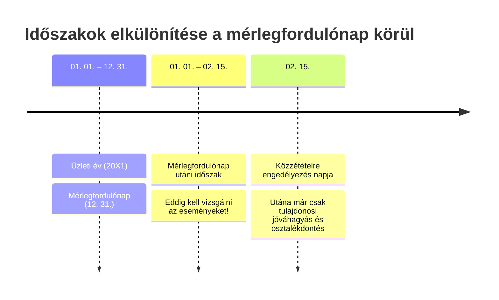

# 📊 Kötelezettségek, céltartalékok; Devizás tételek; Mérlegfordulónap utáni események

> [!abstract] Rövid összefoglaló
> Ez a jegyzet a mérlegfordulónapi zárás három kritikus számviteli területét dolgozza fel: a bizonytalan összegű vagy esedékességű **céltartalékok** és a mérlegen kívüli **függő tételek** elhatárolását, az **idegen pénznemben** fennálló tételek bekerülési, kivezetési és év végi átértékelési szabályait, valamint a **mérlegfordulónap utáni események** időbeli elhatárolását (*cut-off*). Külön hangsúlyt kapnak a gyakorlati könyvelési lépések és a vizsgatípusú esettanulmányok megoldásai.

---

## 1. Kötelem, kötelezettség és céltartalék

A számvitelben a jövőbeni erőforrás-kiáramlással járó tételeket a bizonytalanság foka alapján különítjük el egymástól.

> [!definition] Kötelem
> A gazdálkodó elkötelezettsége arra, hogy valamit teljesítsen vagy rendezzen. Két forrásból eredhet:
> * **Jogi kötelem:** Szerződésből, jogszabályból vagy egyéb jogi műveletből fakad (pl. perbeli kártérítés, szerződéses garancia).
> * **Vélelmezett kötelem:** A gazdálkodó által „szabadon” vállalt elkötelezettség, amely korábbi kialakult gyakorlatából vagy nyilvános ígéreteiből fakad (pl. jó hírnév megőrzése miatti önkéntes visszahívás).

> [!definition] Céltartalék (Becsült kötelezettség)
> Olyan **meglévő kötelem** (múltbéli esemény következménye), amelynek a **felmerülése (időpontja/ténye) és/vagy az összege bizonytalan**, de az erőforrás-kiáramlás valószínű és megbízhatóan becsülhető.

### A fogalmak összehasonlítása

| Szempont | Kötelezettség | Céltartalék | Függő tétel (kötelezettség) |
| :--- | :--- | :--- | :--- |
| **Bizonytalanság foka** | „Szinte” biztos | Valószínű, de bizonytalan | Bizonytalan / jövőbeli eseménytől függ |
| **Kötelem jellege** | Meglévő kötelem | Meglévő kötelem | Jövőbeli kötelem, vagy nem mérhető |
| **Összeg és időpont** | Pontosan ismert (vagy közel pontos) | Bizonytalan (becsülni kell) | Nem mérhető megbízhatóan |
| **Megjelenés a mérlegben** | Kötelezettségek között | Céltartalékok (vagy kötelezettségek) között | **SEHOGY** (csak közzététel!) |

> [!done] 💡 Érthető magyarázat
> Képzelj el egy háztartási gépeket gyártó céget, amely **5 év garanciát** vállal a konyhai robotgépeire:
> * Ha megjött a villanyszámla $\rightarrow$ **Kötelezettség** (tudod, mennyit és mikor kell fizetni).
> * Ha eladtál 10 000 robotgépet 5 év garanciával $\rightarrow$ **Céltartalék** (az eladás már megtörtént, biztosan lesznek meghibásodások, de még nem tudod pontosan, melyik nap hány gép romlik el és mennyibe fog kerülni a javítás).
> * Ha egy ügyfél perrel fenyegetőzik, de a jogászok szerint kicsi az esélye, hogy nyer $\rightarrow$ **Függő tétel** (nem könyveled be a mérlegbe, csak megemlíted a kiegészítő mellékletben).

### A céltartalék kimutatásának 3 együttes feltétele

Céltartalékot **kizárólag akkor** szabad és kell képezni, ha mindhárom feltétel egyszerre teljesül:
1. **Múltbéli eseményből fakadó meglévő kötelem:** A kötelezettséget kiváltó esemény a mérlegfordulónapig már megtörtént (pl. a terméket értékesítették, a környezetszennyezés megtörtént).
2. **Erőforrás-kiáramlással jár:** Valószínű ($> 50\%$), hogy a kötelem rendezése gazdasági hasznossággal járó javak kiáramlásával jár.
3. **Megbízhatóan mérhető:** A kötelem összege észszerű becsléssel meghatározható.

> [!danger] Jövőbeli működési veszteségre TILOS céltartalékot képezni!
> Ha a menedzsment úgy látja, hogy a jövő évben veszteséges lesz a vállalat, arra **nem képezhető céltartalék**, mert hiányzik a múltbéli eseményből fakadó meglévő kötelem!

### Döntési mátrix valószínűség alapján

| Bekövetkezés valószínűsége | Számviteli minősítés | Kezelés |
| :--- | :--- | :--- |
| $95\%$ fölött | Gyakorlatilag biztos | **Céltartalék** (vagy kötelezettség) lesz |
| $50\%+$ – $95\%$ | Valószínű (*inkább valószínű, mint nem*) | **Céltartalék** lesz |
| $10\%$ – $50\%$ | Lehetséges | **Függő kötelezettség** lesz (közzététel) |
| $10\%$ alatt | Esetleges | **Semmi** (még közzétenni sem kell) |

### Első és követő értékelés: A legjobb becslés módszerei

A céltartalékot a **fordulónapi viszonyok** alapján a **legjobb becslés** (*best estimate*) összegében kell értékelni, és minden mérlegfordulónapon újra kell vizsgálni.

1. **Egyedi becslés (Módusz):** Egyetlen, egyszeri eseménynél (pl. egyedi peres ügy) a **legvalószínűbb kimenetel** összege.
2. **Intervallum közepe:** Ha egy folytonos sávon belül minden érték egyforma eséllyel fordulhat elő, a tartomány számtani közepe.
3. **Valószínűségekkel súlyozott átlag (Várható érték):** Sok hasonló tételből álló sokaságnál (pl. garanciális javítások) a kimenetelek valószínűségekkel súlyozott átlaga:

$$Varhato\_ertek = \sum_{i=1}^{n} P_i \cdot X_i$$

### Számviteli kezelés és a „visszafordulás” logikája

* **Képzéskor (tárgyévben):** A várható költséget/ráfordítást már most elszámoljuk az eredmény terhére (mintha már felmerült volna), ezzel szemben a források között felveszünk egy céltartalékot.
* **Felhasználáskor / lezáruláskor (következő évben):** Megtörténik a **visszafordulás** (a céltartalék feloldása az eredmény javára), miközben a ténylegesen felmerült ráfordítást elszámoljuk. Így a lezárás évét **csak a becslés és a tény közötti különbözet** terheli!

> [!example] Kidolgozott példa: Peres ügy és visszafordulás
> **Feladat:** A társaság ellen pert indítottak egy 20X1. évi szerződésszegés miatt. A jogászok szerint valószínű ($>50\%$), hogy $10\text{ MFt}$ kártérítést kell fizetni. A per 20X2 végén lezárul, a jogerős ítélet **$13\text{ MFt}$** kártérítésre kötelezi a céget.
>
> **1. Könyvelés 20X1-ben (céltartalék képzése):**
> * `T Egyéb ráfordítások` $10\,000\text{ eFt}$ — `K Céltartalékok` $10\,000\text{ eFt}$
>
> **2. Könyvelés 20X2-ben (visszafordulás és tényleges kártérítés):**
> * *Feloldás:* `T Céltartalékok` $10\,000\text{ eFt}$ — `K Egyéb bevételek` $10\,000\text{ eFt}$
> * *Tényleges tétel:* `T Egyéb ráfordítások` $13\,000\text{ eFt}$ — `K Kártérítési kötelezettség / Pénzeszköz` $13\,000\text{ eFt}$
>
> | Eredményhatás (előjelhelyesen) | 20X1. év | 20X2. év | Összesen |
> | :--- | :---: | :---: | :---: |
> | Tényleges esemény hatása | $0\text{ MFt}$ | $-13\text{ MFt}$ | $-13\text{ MFt}$ |
> | Céltartalék képzés / feloldás | $-10\text{ MFt}$ | $+10\text{ MFt}$ | $0\text{ MFt}$ |
> | **Éves eredményhatás összesen** | **$-10\text{ MFt}$** | **$-3\text{ MFt}$** | **$-13\text{ MFt}$** |

### A céltartalék helye a mérlegben
A számviteli rendszertől függően kétféle megjelenítési mód létezik:
* **Külön főcsoportként:** Egy külön soron jelenik meg az egész téma a saját tőke és a kötelezettségek között (magyar számviteli gyakorlat).
* **A kötelezettségekkel együtt:** Esedékesség szerint megbontva a **hosszú távú** és a **rövid távú** kötelezettségek között (IFRS-szemlélet).

> [!example] Gyakorló esettanulmányok (Kell-e céltartalék, mikor és mennyi?)
> 1. **Jövő évi $20\text{ Mrd Ft}$-os várható veszteség:** **NEM** képezhető céltartalék (nincs múltbéli eseményből fakadó meglévő kötelem).
> 2. **$10\,000\text{ db}$ eladott termékre garancia ($3\%$ hibaesély, $100\text{ eFt/db}$ javítás):** **IGEN**, az eladás évében! Nagy elemszámú sokaságnál várható értékkel számolunk:
>    $$Celtartalek = 10\,000 \cdot 0,03 \cdot 100\text{ eFt} = 30\,000\text{ eFt} = 30\text{ MFt}$$
> 3. **Peres ügy ($25\%$ eséllyel $50\text{ MFt}$, $40\%$ eséllyel $20\text{ MFt}$, $35\%$ eséllyel $0\text{ Ft}$):** **IGEN**, mert a fizetés összvalószínűsége $25\% + 40\% = 65\% > 50\%$. Mivel egyedi peres ügyről van szó, a **legvalószínűbb kimenetel** (módusz) alapján **$20\text{ MFt}$** céltartalékot képezünk.
> 4. **20X0 decemberében felmondtak 3 dolgozónak, a végkielégítés $10\text{ MFt}$:** **NEM céltartalék, hanem már KÖTELEZETTSÉG!** A felmondás megtörtént, az összeg és a kifizetés is biztos.

---

## 2. Devizás tételek számvitele

> [!definition] Funkcionális és idegen pénznem
> * **Funkcionális pénznem:** Annak az elsődleges gazdasági környezetnek a pénzneme, amelyben a gazdálkodó működik és könyveit vezeti (pl. HUF).
> * **Idegen pénznem (deviza):** Minden olyan pénznem, amely eltér a gazdálkodó funkcionális pénznemétől (pl. EUR, USD).

> [!definition] Árfolyamkülönbözet (ÁK)
> Az a különbözet, amely kizárólag abból fakad, hogy egy idegen pénznem árfolyama időről időre változik, így ugyanazon devizaösszeg funkcionális pénznemben kifejezett értéke eltérő lesz.

### Monetáris vs. Nem monetáris elemek

Az év végi átértékelés szempontjából kulcsfontosságú különbséget tenni a két csoport között:

| Jellemző | Monetáris elemek | Nem monetáris elemek |
| :--- | :--- | :--- |
| **Lényege** | **Pénzt mozgat** (pénzeszköz, vagy meghatározott pénzösszegben befolyó/fizetendő tétel) | **Pénzt már nem mozgat** (termékben, szolgáltatásban vagy tőkében teljesül) |
| **Példák** | Devizaszámla, valuta, vevőkövetelések, szállítói tartozások, hitelek | Tárgyi eszközök, immateriális javak, készletek, adott/kapott előlegek |
| **Árfolyamkülönbözet** | **LEHET** (kivezetéskor és év végén is) | **NINCS, NEM LEHET!** (bekerülési árfolyamon befagy) |

> [!done] 💡 Érthető magyarázat
> Ha rendelsz egy gépet Németországból és már ki is fizetted előlegként (vagy megérkezett a raktárba), akkor a gép értéke forintban „befagyott”, mert már nem fogsz érte eurót utalni vagy kapni (**nem monetáris**). Ha viszont még tartozol a német szállítónak $1000\text{ EUR}$-val, akkor az euró árfolyamának ingadozása közvetlenül befolyásolja, hány forintba fog kerülni a tartozásod rendezése (**monetáris**).

### Kezelés a 3 kulcsidőpontban

1. **Bekerüléskor (amikor a tétel „bejön”):** A teljesítés napi (**spot**) választott árfolyamon (itthon szokásosan az **MNB árfolyamon**) váltjuk át funkcionális pénznemre. $\rightarrow$ *Nincs ÁK.*
2. **Kikerüléskor (kiegyenlítéskor):** A fennálló követelést/kötelezettséget a **könyv szerinti értéken** vezetjük ki, a befolyó/kifizetett pénzt pedig a napi árfolyamon rögzítjük. A kettő különbözete a **realizált árfolyamkülönbözet**.
3. **Év végén (mérlegfordulónapon):** Kizárólag a **monetáris elemeket** értékeljük át a fordulónapi árfolyamra. A keletkező eltérés a **nem realizált árfolyamkülönbözet**.

$$Arfolyamkulonbozet = Devizaosszeg \cdot (Arfolyam_{uj} - Arfolyam_{konyv\_szerinti})$$

> [!warning] Választott árfolyam és eredménykimutatás-sor
> Az alkalmazott árfolyam-politikát **konzisztensen** kell használni! Mind a realizált, mind a nem realizált árfolyamkülönbözetet az eredmény terhére vagy javára, a **pénzügyi eredményt** érintve (*Pénzügyi műveletek bevételei* vagy *ráfordításai*) kell elszámolni.

> [!example] Kidolgozott példa: Devizás vevőkövetelés teljes életútja
> **Adatok:**
> * **20X1. XII. 1.:** Kiszámlázás külföldi vevőnek $1000\text{ EUR}$ értékben (árfolyam: $380\text{ Ft/EUR}$).
> * **20X1. XII. 27.:** A vevő kiegyenlíti a követelés $60\%$-át ($600\text{ EUR}$) a devizaszámlánkra (árfolyam: $390\text{ Ft/EUR}$).
> * **20X1. XII. 31.:** Év végi zárás (árfolyam: $393\text{ Ft/EUR}$).
>
> **1. Bekerülés (XII. 1.):**
> * Érték: $1000\text{ EUR} \times 380\text{ Ft/EUR} = 380\,000\text{ Ft}$
> * Könyvelés: `T Külföldi vevők` $380\,000\text{ Ft}$ — `K Értékesítés árbevétele` $380\,000\text{ Ft}$
>
> **2. Részleges kiegyenlítés (XII. 27. – Realizált ÁK):**
> * Devizaszámlára befolyik ($600\text{ EUR}$ napi árfolyamon): $600 \times 390 = 234\,000\text{ Ft}$ (`T Devizaszámla`)
> * Vevőkövetelés kivezetése könyv szerinti értéken: $600 \times 380 = 228\,000\text{ Ft}$ (`K Külföldi vevők`)
> * **Realizált árfolyamnyereség:** $600 \cdot (390 - 380) = +6\,000\text{ Ft}$ (`K Pénzügyi bevételek`)
>
> **3. Év végi átértékelés (XII. 31. – Nem realizált ÁK):**
> * *Megmaradt vevőkövetelés ($400\text{ EUR}$, nyilvántartási árfolyam $380$):*
>   $$AK_{vevo} = 400 \cdot (393 - 380) = +5\,200\text{ Ft}$$
>   (`T Külföldi vevők` $5\,200\text{ Ft}$ — `K Pénzügyi bevételek` $5\,200\text{ Ft}$)
> * *Devizaszámla egyenlege ($600\text{ EUR}$, nyilvántartási árfolyam $390$):*
>   $$AK_{deviza} = 600 \cdot (393 - 390) = +1\,800\text{ Ft}$$
>   (`T Devizaszámla` $1\,800\text{ Ft}$ — `K Pénzügyi bevételek` $1\,800\text{ Ft}$)
> * **Összes nem realizált árfolyamnyereség:** $5\,200 + 1\,800 = 7\,000\text{ Ft}$.

---

## 3. Mérlegfordulónap utáni események („cut-off”)

A számvitel periodikussága miatt a folyamatosan zajló gazdasági életet mesterségesen el kell vágni a **mérlegfordulónapon** (pl. december 31.). Azonban a beszámoló elkészítése időbe telik, és ezen időszak alatt új információk, események merülhetnek fel.

> [!definition] Mérlegfordulónap utáni események
> Azok a kedvező vagy kedvezőtlen események, amelyek a **mérlegfordulónap** és a **pénzügyi kimutatások közzétételre való engedélyezésének napja** között következnek be.

> [!cite] A döntés legfőbb aranyszabálya
> **„Vigyázat! Nem az INFÓ számít, hanem az esemény (történés)!”**
> Ha a kiváltó ok már a mérlegfordulónapon fennállt (vagy nagyon valószínű, hogy fennállt), akkor az esemény módosító – függetlenül attól, hogy csak januárban vagy februárban szereztünk róla tudomást.

### Módosító vs. Nem módosító események

| Kategória | Módosító események | Nem módosító események |
| :--- | :--- | :--- |
| **Ok fennállása a fordulónapon** | **IGEN**, a körülmény már fennállt december 31-én | **NEM**, az esemény a fordulónap után keletkezett |
| **Számviteli teendő** | **Módosítani kell** a beszámolót (könyveljük; mérleg, eredménykimutatás változik) | **Módosítani TILOS!** (lényeges esetben *közzétesszük* a természetét és várható hatását) |
| **Tipikus példák** | • Eszköz értékvesztése már fennállt a MF-on • MF utáni bírósági ítélet korábbi ügyben • Üzleti évhez kapcsolódó prémiumok • Korábbi csalások, hibák felfedezése | • Eszköz megsemmisülése a MF után (tűz, árvíz) • Osztalék elhatározása a MF után • Fordulónap utáni káresemények |

> [!tip] Hogyan döntsd el vizsgán?
> Tedd fel magadnak a kérdést: *„Ha december 31-én mindent tudtam volna a jövőről, más értéken szerepeltettem volna ezt a tételt a mérlegben?”* Ha a válasz **igen** (pl. a készlet már akkor eladhatatlan volt, a vevő már akkor fizetésképtelen volt), akkor **módosító eseményről** van szó!

> [!example] Gyakorló feladat: Besorolás módosító (M) vagy nem módosító (NM) kategóriába
> 1. **Szilveszteri bulin éjfélkor tűzijáték miatt kigyulladt és porig égett az üzem:**
>    * **Nem módosító (NM)** – A tűzeset éjfélkor, már az új üzleti évben (a mérlegfordulónap után) történt. A lezárt év mérlegét nem módosíthatja, de rendkívüli nagyságrendje miatt a kiegészítő mellékletben **közzé kell tenni**.
> 2. **Egyik készletünket január 15-én a bekerülési költség alatt $15\%$-kal adtuk el:**
>    * **Módosító (M)** – A januári értékesítési ár bizonyítja, hogy a készlet piaci értéke már december 31-én alacsonyabb volt a bekerülési értéknél. Értékvesztést kell elszámolni a lezárt évre.
> 3. **Vevőnk ellen felszámolási eljárás indult; a felszámoló jelzi, hogy semmi sem térül meg:**
>    * **Módosító (M)** – A partner fizetésképtelensége nem egyik napról a másikra alakult ki, a követelés már a fordulónapon behajthatatlan volt (értékvesztést kell elszámolni).
> 4. **Árvíz volt január 31-én, az árukészlet fele elázott ($50\%$-os értékvesztés):**
>    * **Nem módosító (NM)** – Az árvíz a fordulónap utáni káresemény, így a lezárt üzleti év számait tilos módosítani vele (indokolt esetben közzétesszük).

---

## 🎯 Vizsgafelkészítő önellenőrző kérdések

> [!faq]- Mi a különbség a céltartalék és a függő kötelezettség között, és hogyan jelennek meg a pénzügyi kimutatásokban?
> * **Céltartalék:** Múltbéli eseményből fakadó **meglévő kötelem**, amelynél valószínű ($>50\%$) az erőforrás-kiáramlás és az összege megbízhatóan becsülhető, de az összege és/vagy a felmerülés időpontja bizonytalan. A **mérlegben** (források között) kimutatjuk.
> * **Függő kötelezettség:** Olyan lehetséges kötelem, amelynek létrejötte jövőbeli bizonytalan eseménytől függ, vagy meglévő kötelem ugyan, de az erőforrás-kiáramlás nem valószínű ($10\%\text{–}50\%$), illetve az összege nem mérhető megbízhatóan. A **mérlegben SEHOGY** nem szerepel, kizárólag a kiegészítő mellékletben **közzétesszük**.

> [!faq]- Mi a „visszafordulás” szerepe a céltartalékok könyvelésében, és miért nem okoz kétszeres ráfordítás-elszámolást?
> A céltartalék képzésekor a várható ráfordítást már a kötelezettség keletkezésének évében elszámoljuk. Amikor a későbbi évben az esemény ténylegesen bekövetkezik, elszámoljuk a teljes tényleges ráfordítást, **de ezzel egyidejűleg feloldjuk (visszafordítjuk) a korábban képzett céltartalékot** az eredmény javára. Így a lezárás évének eredményét kizárólag a korábbi becslés és a tényleges összeg közötti különbözet módosítja.

> [!faq]- Mi a különbség a monetáris és a nem monetáris devizás elemek között az év végi értékelés szempontjából?
> * **Monetáris elemek** (amelyek pénzt mozgatnak, pl. devizaszámla, devizás vevőkövetelés, szállítói tartozás): Év végén kötelező átértékelni őket a fordulónapi árfolyamra, és a keletkező **nem realizált árfolyamkülönbözetet** a pénzügyi eredményben el kell számolni.
> * **Nem monetáris elemek** (amelyek már nem mozgatnak pénzt, pl. devizáért vásárolt tárgyi eszköz, készlet, adott előleg): Év végén **nem értékelhetők át**, bekerülési árfolyamon rögzítve maradnak, így nem keletkezik rajtuk árfolyamkülönbözet.

> [!faq]- Meddig tart a mérlegfordulónap utáni események vizsgálati időszaka, és mi a döntő szempont abban, hogy módosítani kell-e a beszámolót?
> A vizsgálati időszak a **mérlegfordulónaptól** (pl. december 31.) a **pénzügyi kimutatások közzétételre való engedélyezésének napjáig** tart. A döntő szempont nem az információ beérkezésének dátuma, hanem az, hogy **az eseményt kiváltó ok már a mérlegfordulónapon fennállt-e**: ha igen, akkor módosító esemény (számszakilag korrigálni kell a lezárt évet); ha a fordulónap után keletkezett, akkor nem módosító esemény (tilos módosítani, legfeljebb közzétesszük).

> [!faq]- Egy társaság 20X1-ben 5 000 darab terméket adott el 2 év garanciával. A tapasztalatok szerint a termékek 4%-a hibásodik meg, az átlagos javítási költség 50 eFt/db. Emellett a menedzsment 20X2-re 15 MFt működési veszteséget tervez. Mennyi céltartalékot kell képezni 20X1 végén?
> * **Garanciára:** $5\,000 \cdot 0,04 \cdot 50\text{ eFt} = 10\,000\text{ eFt} = \mathbf{10\text{ MFt}}$ céltartalékot kell képezni (múltbéli esemény az eladás, sokaságra valószínűséggel súlyozott becslést alkalmazunk).
> * **Jövő évi veszteségre:** **$0\text{ Ft}$** (jövőbeli működési veszteségre tilos céltartalékot képezni, mert nincs múltbéli eseményből fakadó meglévő kötelem).
> * **Összesen 20X1 végén:** **$10\text{ MFt}$** céltartalékot kell kimutatni.