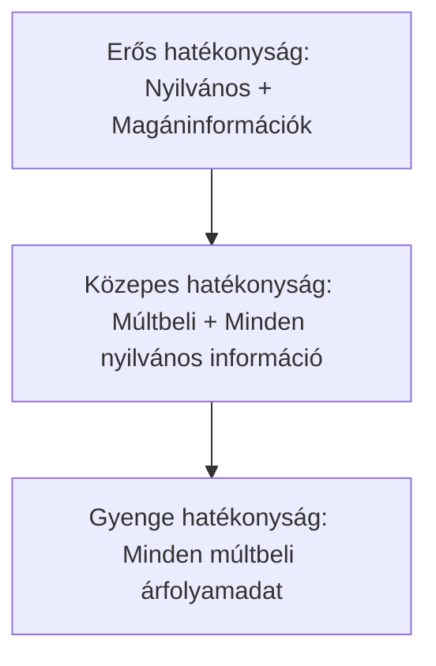

> [!abstract] Rövid összefoglaló
> Az előadás első fele a **hatékony piacok elméletét (EMH)**, annak három szintjét, befektetési és vállalati következményeit, valamint a piaci hatékonyságot korlátozó viselkedési és strukturális tényezőket tárgyalja. A második rész a vállalatok **kifizetési és osztalékpolitikáját** mutatja be a tökéletes piacokon érvényes **Miller–Modigliani-irrelevanciatételtől** a gyakorlati tényezőkig (jelzéselmélet, osztaléksimítás, adózás), egy teljes kidolgozott ZH-feladattal kiegészítve.

---

# I. Hatékony piacok elmélete (Efficient Markets)

## 1. A hatékony piac hipotézise: Fama vs. Jensen

A tőkepiacok hatékonysága azt méri, hogy az értékpapírok ára mennyire gyorsan és pontosan tükrözi a rendelkezésre álló információkat. Két alapvető megközelítést különítünk el:

> [!definition] Hatékony piac hipotézise – Eugene Fama (2013-as Nobel-díjas)
> A piaci ár az **összes rendelkezésre álló információt** maradéktalanul tükrözi. A részvényárak napról napra történő mozgása nem mutat semmilyen előrejelezhető mintázatot: statisztikailag **véletlenszerű** (*random walk*), ugyanakkor hosszú távon **pozitív** várható hozamú.

> [!definition] Hatékony piac hipotézise – Michael Jensen
> A rendelkezésre álló információk alapján történő kereskedéssel **nem lehet többlethozamot** (adókkal, tranzakciós költségekkel és kockázattal korrigált extra hozamot) elérni. Hatékony piacon egy extra információt felhasználó stratégia várható hozama és tranzakciós költségei kiegyenlítik az információ nélküli hozamot:
> $$E(r_{\text{extra info}}) + c_{\text{tranzakcio}} = E(r_{\text{base}})$$
> *(ahol $E(r_{\text{extra info}})$ az extra információval elérhető nettó várható hozam, $c_{\text{tranzakcio}}$ a tranzakciós és elemzési költség, $E(r_{\text{base}})$ pedig az információ nélküli várható hozam).*

> [!example] Mi a gyakorlati különbség? (A 300 USD-s részvény példája)
> Ha egy részvény jövőbeli osztalékainak jelenértéke pontosan 300 USD:
> - **Fama szerint:** A piac csak pontosan 300 USD-s árfolyamnál hatékony ($P = 300\text{ USD}$).
> - **Jensen szerint:** A piac 299,95 USD-s árnál is **hatékony marad**, ha a kereskedési stratégia tranzakciós költsége legalább 5 cent részvényenként ($c_{\text{tx}} \ge 0.05\text{ USD}$). Ha a költség 5 centnél kevesebb, az elemző többlethozamot érhet el, így a piac már **nem hatékony**.

> [!done] 💡 Érthető magyarázat: A földön heverő aprópénz
> A szigorú **Fama-elmélet** szerint a forgalmas folyosón nem heverhet igazi pénz a földön, mert valaki már felvette volna. A gyakorlatiasabb **Jensen-elmélet** szerint egy 5 forintos simán ott maradhat a padlón, mert a lehajolás fáradtsága (tranzakciós költsége) nagyobb, mint maga az 5 forint – tehát nem éri meg felvenni, a piac így is hatékony.

---

## 2. A piaci hatékonyság három formája

A hatékonyság szintjei **egymásba ágyazottak**: minden magasabb szint automatikusan magában foglalja az alacsonyabb szinteket is.

| Hatékonysági forma | Mit tükröz a piaci ár? | Mivel NEM érhető el többlethozam? | Valós piaci tapasztalat |
| :--- | :--- | :--- | :--- |
| **Gyenge** (*Weak-form*) | Minden **múltbeli** ár- és kereskedési adatot | **Technikai elemzés** (grafikonok, trendek) | Rövid távon nagyrészt teljesül |
| **Közepes** (*Semistrong-form*) | Múltbeli + minden **nyilvános** információt (hírek, mérlegek) | **Fundamentális elemzés** (és technikai) | Fejlett piacokon jól érvényesül |
| **Erős** (*Strong-form*) | Nyilvános + **magáninformációkat** (bennfentes adatok) | **Semmivel** (még bennfentes kereskedéssel sem) | **Nem teljesül** a gyakorlatban |

> [!cite] A gyenge hatékonyság aranyszabálya (Carrefour-példa)
> „A piacnak nincs emlékezete!”

*Értelmezés:* Hiába látunk egy részvény (pl. Carrefour) múltbeli grafikonján szabályosan emelkedő hullámokat, gyenge hatékonyság mellett a múltbeli mintázat semmit nem árul el a holnapi árfolyamról.

---

## 3. A piaci hatékonyság következményei

### Gyenge szint: Véletlenszerű bolyongás (*Random Walk*)
- Az egymást követő napi árfolyamváltozások függetlenek egymástól (pl. a **BP** részvényének $t$. és $t+1$. napi hozama közötti korreláció gyakorlatilag nulla: $\rho = -0.033$).
- Versenyző piacokon, amint a befektetők megpróbálnának kihasználni egy múltbeli mintát, az árak **azonnal alkalmazkodnak**, eltüntetve a könnyű profitot.

### Közepes szint: 5 alapvető következmény

1. **Nincsenek „jó” és „rossz” (kockázattal korrigált) befektetések**
   > [!example] Apple vs. Philip Morris
   > Az **Apple** jó vállalat (piacvezető iPhone), a **Philip Morris** rosszabb kilátású (zsugorodó dohánypiac). Mivel ezt *mindenki tudja*, az Apple részvénye drága, a Philip Morrisé olcsó. Kockázattal korrigálva egyik sem jobb befektetés a másiknál: mindkettő fair áron forog.

2. **A befektetőknek a piaci portfóliót érdemes tartaniuk**
   - Mivel a fundamentális elemzés nem hoz tartós többlethozamot, pénzkidobás drága, aktívan menedzselt alapokat venni a **passzívan menedzselt** (pl. S&P 500 indexkövető), maximálisan diverzifikált **piaci portfólióval** szemben.

3. **Az árak a cég fundamentális értékét mutatják**
   - Bár egy vezérigazgató többet tudhat, mint egyetlen egyéni kereskedő, a részvényárfolyam **befektetők millióinak** kollektív tudását és véleményét aggregálja, ami gyakran többet mond még a menedzser információinál is.

4. **Eseményvizsgálat (*Event Study*) és abnormális hozamok**
   - Ha a piac hatékony, a jó események emelik, a rosszak csökkentik az árfolyamot. Megfordítva: ha bizonytalanok vagyunk egy esemény (pl. akvizíció) értékteremtő hatásában, a piaci árfolyamreakcióból kiolvashatjuk annak értékét.
   - **Időablakok:** Becslési ablak ($t_1$ és $t_2$ között, normál hozam becslése) $\rightarrow$ Esemény előtti ablak (*pre-event*) $\rightarrow$ Eseményablak ($-k$, maga a $t$ esemény és $+l$) $\rightarrow$ Esemény utáni ablak (*post-event*).

5. **A finanszírozási döntések nem teremtenek és nem rombolnak értéket**
   > [!danger] Kulcsfontosságú vállalati pénzügyi szabály!
   > Mivel a hatékony piacon az adósság és a részvények ára is **fair**, önmagában a finanszírozási döntésekkel (pl. részvénykibocsátással, hitelfelvétellel) nem lehet értéket teremteni vagy rombolni.

---

## 4. Vagy mégsem hatékony a piac? – Ellentmondások

A valóságban öt fő tényező gyengíti a piaci hatékonyságot:
- **Hosszú távú mintázatok:** Hosszabb időtávon bizonyítékok vannak arra, hogy az árak nem teljesen véletlenszerűen bolyonganak.
- **Bennfentes kereskedés:** A vállalati vezetők és igazgatók belső információikkal bizonyítottan képesek legyőzni a piacot (megdől az erős hatékonyság).
- **Viselkedési pénzügyek (*Behavioral Finance*):** Az emberek nem mindig racionálisak; pszichológiai torzítások vezethetnek félreárazáshoz:
  - *Veszteségkerülés (Loss aversion)* – a veszteség jobban fáj, mint amennyire az azonos nyereség örömet okoz.
  - *Túlzott önbizalom (Overconfidence)* – saját elemzői képesség túlbecslése.
  - *Ökölszabályok (Rules of thumb)* – leegyszerűsített döntési sémák.
  - *Megbánás (Regret)* – a tévedés beismerésének kerülése.
  - *Csordaszellem (Herding)* – a tömeg vak követése.
  - *Mentális könyvelés (Mental accounting)* – a pénz eredet szerinti eltérő kezelése.
  - *Korlátozott figyelem (Limited attention span)* – szelektív információfeldolgozás.
- **Az arbitrázs korlátai:** Bár az arbitrázs lenne a hatékonyság motorja, a **tranzakciós költségek** és a **nem fedezhető kockázatok** megakadályozhatják a racionális befektetőket a félreárazások kijavításában.
- **Ügynöki és ösztönző problémák:** A pénzügyi közvetítők (pl. alapkezelők) saját ösztönzőrendszere hatékonysági torzulásokat okozhat.

---

# II. Osztalékpolitika (Payout Policy)

## 1. Az adózott eredmény sorsa és az MM-világ

A megtermelt adózott eredményt a vállalat vagy **visszatartja** ($NPV > 0$ projektek megvalósítására), vagy **kifizeti** a tulajdonosoknak **osztalékfizetés** vagy **részvény-visszavásárlás** formájában.

> [!definition] Miller–Modigliani (1961) osztalék-irrelevanciatétel
> **Tökéletes tőkepiacon** (adók, tranzakciós költségek és piaci tökéletlenségek nélkül) az osztalékpolitikának **NINCS hatása a vállalat értékére**. Az elmélet (a „középutasok” / *middle-of-the-road party* álláspontja) csak **rögzített eszköz-, beruházási és hitelpolitika** mellett értelmezhető.

Mivel a befektetőknek nincs szükségük osztalékra ahhoz, hogy részvényeiket készpénzre váltsák (bármikor eladhatnak a portfóliójukból), nem fizetnek magasabb árat a bőkezűbben osztalékozó cégekért.

> [!done] 💡 Érthető magyarázat: A pizza és a két pénzeszsák
> A vállalat értéke egy pizza: attól, hogy másképp szeleteled fel (osztalékot fizetsz vagy sem), nem lesz több pizzád. Ha egy 10 Ft-os részvény kifizet 1 Ft osztalékot, a részvényed 9 Ft-ot ér majd, a zsebedben pedig ott az 1 Ft készpénz – az összvagyonod maradt 10 Ft.

**Mi történik, ha nincs elég adózott eredmény, de a tulajdonosnak pénzre van szüksége?** Tökéletes piacon két azonos hatású út létezik (100 Ft-os cégérték mellett):
1. **Tulajdonos cselekszik:** Részlegesen elad a részvényeiből (pl. A elad B-nek és C-nek). A pénzmozgás a régi és új tulajdonosok között történik, a cég értéke 100 Ft marad.
2. **Vállalat cselekszik:** Új részvényeket bocsát ki (pl. 6 db-ról 10 db-ra emeli a részvényszámot), a befolyt pénzből pedig osztalékot fizet a régi tulajdonosoknak. A pénzmozgás a cég és a tulajdonosok között történik, a cég értéke marad 100 Ft, a régi tulajdonosok tulajdoni hányada csökken, de összvagyonuk változatlan.

---

## 2. Kifizetési módok és kulcsdátumok

### Osztalékfizetés és visszavásárlás típusai
- **Készpénzosztalék (*Cash Dividend*):** Készpénz szétosztása – lehet **rendszeres** (stabilan várt) vagy **extra** (egyszeri).
- **Részvényosztalék (*Stock Dividend*):** Újonnan kibocsátott részvények szétosztása a meglévő tulajdonosok között *(hasonló hatású a részvényaprózódás / stock split is)*.
- **Részvény-visszavásárlás (*Share Repurchase*):** A cég saját részvényeket vásárol vissza négy lehetséges módon:
  1. **Nyílt piacon** (tőzsdén veszi meg),
  2. **Pályázati kiírás (*Tender Offer*)** – fix áras nyilvános ajánlat a részvényeseknek,
  3. **Holland aukció (*Dutch Auction*)** – ársáv megadása, egységes legalacsonyabb elszámolóárral,
  4. **Magánmegegyezés (*Greenmail*)** – egyedi megegyezés egy nagyobb részvényessel.

### A 4 kulcsdátum (Pfizer 0,39 USD-s negyedéves osztalékpéldája)

| Sorrend | Dátum neve | Pfizer-példa | Jelentése |
| :---: | :--- | :--- | :--- |
| 1. | **Bejelentés napja** (*Declaration Date*) | 2020. dec. 11. | Az igazgatóság bejelenti az osztalék összegét és ütemezését. |
| 2. | **Ex-dividend nap** (*Ex-Dividend Date*) | 2021. jan. 28. | Ettől a naptól a részvény osztalékjog nélkül forog (új vevő már nem kapja meg). |
| 3. | **Nyilvántartás napja** (*Record Date*) | 2021. jan. 29. | A részvénykönyvben ezen a napon szereplő tulajdonosok jogosultak a kifizetésre. |
| 4. | **Osztalékfizetés napja** (*Payment Date*) | 2021. márc. 5. | A pénz tényleges kiutalásának / csekkek kiküldésének napja. |

> [!danger] Fontos árfolyam-összefüggés!
> Tökéletes piacon (információtartalom nélkül) az árfolyam az **ex-dividend napon** esik az egy részvényre jutó osztalék összegével – nem a bejelentéskor és nem a kifizetéskor!

### A 3 kifizetési mód összehasonlítása (MM-világ: 100 Ft-os cég, 10 db részvény, 10 Ft/db)

| Jellemző (10 Ft-os / 10%-os művelet után) | Készpénzosztalék (1 Ft/db) | Részvényosztalék (10%) | Részvény-visszavásárlás (1 db) |
| :--- | :--- | :--- | :--- |
| **Cég értéke utána** | 90 Ft (10 Ft kiment) | 100 Ft (nem ment ki pénz) | 90 Ft (10 Ft kiment) |
| **Részvények darabszáma** | Változatlan (10 db) | **Nő** (11 db) | **Csökken** (9 db) |
| **1 db részvény ára** | **Csökken** az osztalékkal (9 Ft) | **Csökken** (9,09 Ft) | **Változatlan** (10 Ft) |
| **Befektető portfóliója** | 1 db (9 Ft) + 1 Ft kp = 10 Ft | 1,1 db (9,09 + 0,91 Ft) = 10 Ft | Maradó: 1 db (10 Ft); Eladó: 10 Ft kp |
| **Tulajdoni arány** | Változatlan | Változatlan | Változik (eladóké csökken, maradók aránya nő) |

---

## 3. Gyakorlati tényezők, amelyek kivezetnek az MM-világból

### Empirikus trendek
- **Nem pénzügyi cégek gyakorlata (2011–2020):** $24.1\%$ fizet osztalékot *és* vásárol is vissza; $23.7\%$ csak visszavásárol; $12.0\%$ csak osztalékot fizet; $40.1\%$ egyiket sem alkalmazza.
- **Nagyvállalatok (2019):** Az Apple (67 mrd USD visszavásárlás, +5% osztalék), Cisco (22 mrd USD, +6%), Citigroup (20 mrd USD, +41%) és Microsoft (20 mrd USD, +10%) mindkét eszközt erőteljesen használja.
- **Nemzetközi kép:** Az USA-ban 1985–2020 között a visszavásárlás vált dominánssá (rugalmasabb, válságban könnyebben visszafogható), míg az Egyesült Királyságban, Ausztráliában, Németországban és Kanadában továbbra is az osztalék dominál (piaci kapitalizáció %-ában).

### Osztaléksimítás és vezetői aggályok (2004-es CFO-felmérés)
A pénzügyi vezetők három fő elvet követnek: **(1)** kerülik a később visszafordítandó változásokat ($77.9\%$); **(2)** **„kisimítják”** az osztalékot ($89.6\%$) és mindenáron kerülik annak csökkentését ($93.8\%$), csak a tartós bevételnövekedést követik; **(3)** a változásokra ($66.7\%$) és a jelenlegi szintre ($88.2\%$) koncentrálnak.

> [!warning] A csökkentés ára
> A vezetők $65.4\%$-a inkább külső forrást vonna be egy nyereséges projekthez, mint hogy osztalékot vágjon, és $42.8\%$-uk szerint a külső tőke költsége alacsonyabb az osztalékcsökkentés okozta kárnál.

### Jelzéselmélet (*Signaling*) és ügyfélköri hatás (*Clientele Effect*)
- **Információtartalom / Jelzés:** Aszimmetrikus információ mellett a kifizetési döntések hiteles piaci jelzést küldenek. Az **osztalékemelés** a tartós jövőbeli cash flow-ba vetett vezetői bizalmat jelzi (mert gyenge cégek számára költséges lenne utánozni; bár a cég múltja alapján esetenként túlárazottságot is jelezhet). Az **osztalékcsökkentés** súlyos rossz hír. A **részvény-visszavásárlás** vezetői magabiztosságot (alulértékeltséget) jelez, ami gyakran abnormális áremelkedést vált ki.
- **Ügyfélkör:** Bár sok befektető kedveli a magas osztalékot (még $PVGO > 0$ cégeknél is), ebből **nem következik**, hogy egy vállalat profitálhat az osztalék növeléséből – ez az ügyfélkör már most is rengeteg magas osztalékú részvény közül választhat.

### Adókövetkezmények és adórendszerek
A vállalatok kifizetési politikájukkal az osztalékot tőkenyereségre válthatják át. Az amerikai CFO-k kb. egyötöde ($20\%$) tartja fontosnak a befektetői adókat, és ahol eltörölték az osztalékok kettős adóztatását, több országban eltolódtak a kifizetések a visszavásárlások felé.

> [!warning] Adózási preferencia
> - Ha $t_{\text{div}} > t_{\text{cg}}$ (az osztalék adója magasabb a tőkenyereség adójánál) $\rightarrow$ a befektetők az **alacsony osztalékú** cégeket preferálják.
> - Ha $t_{\text{div}} < t_{\text{cg}}$ $\rightarrow$ a befektetők a **magas osztalékú** cégeket preferálják.

**Két adórendszer összehasonlítása (100 USD adózás előtti eredményre):**

| Tétel | USA – Kettős adóztatás (21% TAO + 15% SZJA) | Ausztrália – Adójóváírás (30% TAO, 15% SZJA) | Ausztrália – Adójóváírás (30% TAO, 30% SZJA) | Ausztrália – Adójóváírás (30% TAO, 47% SZJA) |
| :--- | :---: | :---: | :---: | :---: |
| Adózás előtti eredmény | 100,00 USD | 100 USD | 100 USD | 100 USD |
| Társasági adó | -21,00 USD | -30 USD | -30 USD | -30 USD |
| **Kifizetett osztalék** | **79,00 USD** | **70 USD** | **70 USD** | **70 USD** |
| Bruttósított adóalap | 79,00 USD | 100 USD | 100 USD | 100 USD |
| SZJA | 11,85 USD | 15 USD | 30 USD | 47 USD |
| Vállalati adójóváírás | – | -30 USD | -30 USD | -30 USD |
| Részvényes fizet (+) / visszakap (-) | +11,85 USD | -15 USD | 0 USD | +17 USD |
| **Nettó jövedelem a részvényesnek** | **67,15 USD** | **85 USD** | **70 USD** | **53 USD** |

> [!tip] Gyors ellenőrzés az ausztrál rendszerhez
> Imputációs rendszerben megszűnik a kettős adóztatás, ezért a részvényesnél maradó nettó összeg mindig pontosan a saját SZJA-kulcsával adózott bruttó eredmény: $100 \cdot (1 - t_{\text{szja}})$ (vagyis 85, 70 és 53 USD).

### Mikor különösen fontos az osztalékfizetés?
Olyan országokban, ahol a vállalatok **átláthatatlanabbak**, gyengébb a vállalatirányítás, és a pénzügyi beszámolók kevésbé megbízhatóak. Ilyenkor a ténylegesen kifizetett készpénzosztalék segít elválasztani a valódi nyerteseket a vesztesektől (a készpénzt nem lehet kreatív könyveléssel meghamisítani).

---

# 🎓 Önellenőrző vizsgakérdések

> [!faq]- Miben tér el Fama és Jensen hatékony piac definíciója, és mikor hatékony Jensen szerint a piac, ha egy 300 USD belső értékű részvény 299,95 USD-ért forog?
> Fama szerint a piaci árnak hajszálpontosan meg kell egyeznie a belső értékkel (300 USD). Jensen definíciója a kockázattal, adókkal és tranzakciós költségekkel korrigált **többlethozam** hiányára épül: a piac 299,95 USD-s árnál is hatékony marad, ha a kereskedési stratégia tranzakciós költsége legalább 5 cent részvényenként, mert így nem marad kihasználható nettó profit.

> [!faq]- Miért mondjuk közepes piaci hatékonyság mellett, hogy egy „jó vállalat” (pl. Apple) nem feltétlenül jobb befektetés, mint egy zsugorodó piacon működő cég (pl. Philip Morris)?
> Közepes hatékonyság esetén minden nyilvános információ azonnal beépül a részvényárba. Mivel a piac tisztában van az Apple erősségével és a Philip Morris piacának zsugorodásával is, az Apple részvénye drágán, a Philip Morrisé olcsón forog – kockázattal korrigálva mindkettő fair árazású, egyikkel sem érhető el szisztematikus többlethozam.

> [!faq]- Melyik a négy osztalékfizetési kulcsdátum, és mikor esik elméletileg a részvény árfolyama az osztalék összegével?
> Időrendben: **1.** Bejelentés napja (*Declaration Date*), **2.** Ex-dividend nap (*Ex-Dividend Date*), **3.** Nyilvántartás napja (*Record Date*), **4.** Osztalékfizetés napja (*Payment Date*). Tökéletes piacon (információtartalom nélkül) az árfolyam az **ex-dividend napon** csökken az osztalék összegével, mert ettől a naptól a vevő már nem jogosult a kifizetésre.

> [!faq]- Miért kerülik a pénzügyi vezetők (a 2004-es felmérés szerint 93,8%-uk) szinte mindenáron az osztalék csökkentését?
> Az információs aszimmetria és a **jelzéselmélet (signaling)** miatt a piac az osztalékvágást a vállalat tartós jövőbeli pénzáramlási képességének súlyos romlásaként értelmezi, ami meredek árfolyamesést vált ki. Emiatt a vezetők kisimítják az osztalékot, és gyakran inkább külső forrást vonnak be, semmint csökkentsék a kifizetést.

> [!faq]- Hogyan működik az ausztrál adójóváírásos rendszer, és mennyi nettó jövedelme marad egy 15%-os SZJA-sávba tartozó részvényesnek 100 USD adózás előtti eredmény után (30%-os társasági adó mellett)?
> A rendszer megszünteti a kettős adóztatást: a cég 100 USD után befizet 30 USD társasági adót és kifizet 70 USD osztalékot. A részvényes 100 USD bruttósított alapra 15 USD SZJA-t számol, amiből levonja a 30 USD vállalati adójóváírást – így 15 USD adót visszakap az államtól, és összesen 85 USD nettó jövedelme marad.