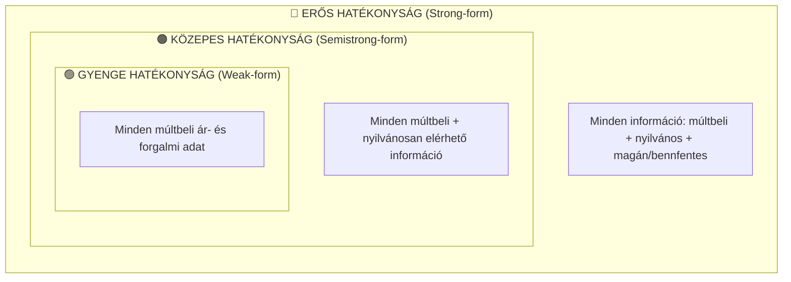
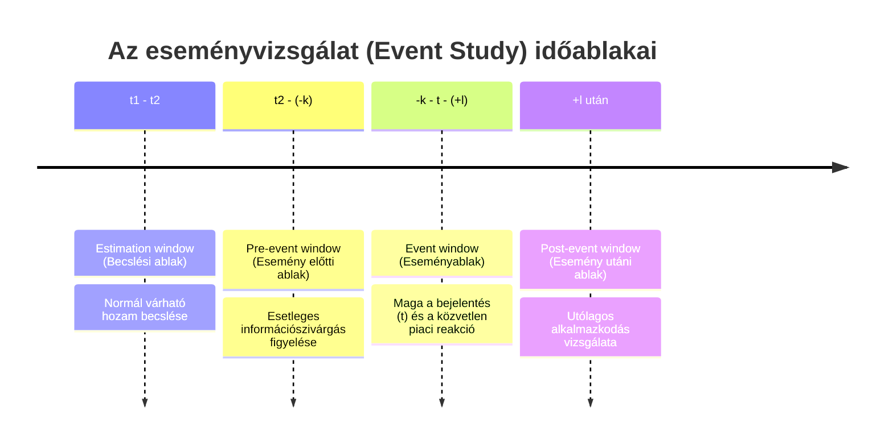
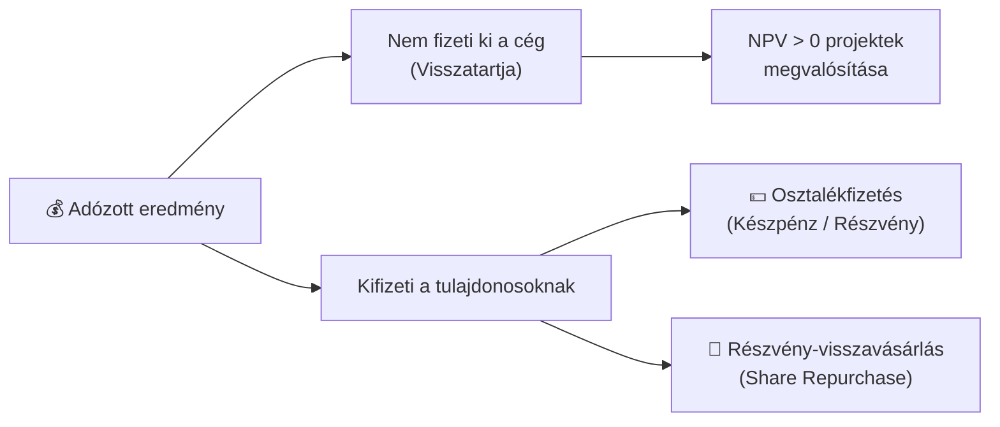

> [!abstract] Rövid összefoglaló
> A jegyzet első fele a **hatékony piacok elméletét (EMH)**, annak három szintjét, gyakorlati következményeit (passzív befektetés, eseményvizsgálat), valamint a piaci hatékonyságot megkérdőjelező jelenségeket (viselkedési torzítások, arbitrázs korlátai) tárgyalja. A második rész a vállalatok **kifizetési és osztalékpolitikáját** mutatja be a tökéletes piacokon érvényes **Miller–Modigliani-irrelevanciatételtől** kezdve a valódi piaci tényezőkön (jelzéselmélet, osztaléksimítás, adózási rendszerek, vállalatirányítás) át egészen egy teljes, lépésről lépésre kidolgozott ZH-feladatig.

---

# I. RÉSZ: A hatékony piacok elmélete (Efficient Markets)

## 1. A hatékony piac hipotézise (EMH)

A pénzügyi piacok vizsgálatának egyik sarokköve az a kérdés, hogy a részvények árfolyama mennyire gyorsan és pontosan építi be az új információkat. A szakirodalom két meghatározó – finom különbséget rejtő – definíciót különít el.

> [!definition] Hatékony piac hipotézise – Eugene Fama (2013-as Nobel-díjas)
> A piaci ár az **összes rendelkezésre álló információt** azonnal és teljes mértékben tükrözi. Ebből következik, hogy a részvényárak napról napra történő mozgása nem mutat semmilyen előrejelezhető mintázatot: statisztikailag az árfolyamok mozgása **véletlenszerű** (*random walk*), ugyanakkor hosszú távon **pozitív trendű** (pozitív várható hozammal bír).

> [!definition] Hatékony piac hipotézise – Michael Jensen
> Egy piac akkor hatékony egy adott információhalmazra nézve, ha a rendelkezésre álló információk alapján történő kereskedéssel **nem lehet többlethozamot (abnormális hozamot) elérni**.
>
> Képlettel kifejezve, egy extra információt felhasználó stratégia esetén a tranzakciós költségekkel korrigált várható hozam megegyezik az információ nélkül elérhető hozammal:
> $$E(r_{\text{extra infóval}}) - c_{\text{tranzakció}} \le E(r_{\text{információ nélkül}})$$
> *(Az előadás megfogalmazásában: az extra információt felhasználó kereskedési stratégia nettó hozama és a tranzakciós költségek együttesen adnak ki egyensúlyt az alapértelmezett várható hozammal, így nem marad kihasználható tiszta profit.)*

### Fama vs. Jensen – Mi a lényegi különbség?

| Szempont | Eugene Fama megközelítése | Michael Jensen megközelítése |
| :--- | :--- | :--- |
| **Központi fogalom** | Pontos információs beárazódás | Kihasználható **többlethozam** hiánya |
| **Árfolyam-elvárás** | Az árnak *hajszálpontosan* meg kell egyeznie a belső értékkel | Kisebb eltérés megengedett, ha nem kifizetődő kijavítani |
| **Költségek szerepe** | Elméleti, súrlódásmentes ideál | Figyelembe veszi az **adókat, tranzakciós költségeket és a kockázatot** |
| **Gyakorlati teszt** | $P_{\text{piaci}} = PV(\text{jövőbeli osztalékok})$ | $\text{Félreárazás} \le \text{Tranzakciós költség}$ |

> [!example] A $\$300$-os részvény példája
> Tegyük fel, hogy egy részvény jövőbeli osztalékainak jelenértéke (belső értéke) pontosan $\$300$.
> - **Fama szerint:** A piac csak akkor hatékony, ha a részvény ára hajszálpontosan **$\$300$**.
> - **Jensen szerint:** A piac akkor is hatékony marad, ha a részvény ára **$\$299{,}95$**, amennyiben a kereskedési stratégia (vétel/eladás, elemzés) tranzakciós költsége **legalább $5\text{ cent}$** ($\$0{,}05$) részvényenként. Ha a költség ennél kevesebb (pl. $\$0{,}02$), akkor a kereskedő kockázat- és költségkiigazított **többlethozamot** tud elérni – ekkor a piac *már nem hatékony*.

> [!done] 💡 Érthető magyarázat: A „földön heverő százforintos” analógia
> Képzeld el, hogy egy forgalmas egyetemi folyosón sétálsz egy pénzügy-professzorral, és meglátsz a földön egy $10\,000\text{ Ft}$-os bankjegyet. A szigorú **Fama-féle** professzor azt mondja: *„Ne is hajolj le érte, biztosan hamis, mert ha igazi lenne, valaki már felvette volna!”* A gyakorlatiasabb **Jensen-féle** professzor viszont egy $5\text{ Ft}$-os érmére mutatva azt mondja: *„Lehet, hogy valódi az az ötforintos, de a lehajolás energiája (tranzakciós költsége) többe kerül, mint $5\text{ Ft}$, ezért racionális otthagyni – a folyosó ettől még hatékony.”*

---

## 2. A hatékony piac három formája

A piaci hatékonyságot aszerint soroljuk három egymásba ágyazott szintre, hogy **milyen körű információkat** tükröznek a részvényárak.

> [!warning] Egymásba ágyazódás szabálya!
> A szintek **hierarchikusak**! Ha egy piac **közepes** szinten hatékony, akkor automatikusan **gyenge** szinten is hatékony. Ha **erős** szinten hatékony, akkor a másik kettő is teljesül. Fordítva ez viszont nem igaz!

| Hatékonysági forma | Beárazott információhalmaz | Melyik módszerrel NEM lehet többlethozamot elérni? | Gyakorlati tapasztalat |
| :--- | :--- | :--- | :--- |
| **Gyenge (Weak-form)** | Minden **múltbeli** árfolyam- és kereskedési adat | **Technikai elemzés** (grafikonok, indikátorok, trendvonalak) | Rövid távon nagyrészt teljesül |
| **Közepes / Félerős (Semistrong-form)** | Múltbeli adatok + minden **nyilvános** információ (mérlegek, hírek, makroadatok, bejelentések) | **Fundamentális elemzés** (és technikai elemzés) | Fejlett piacokon jellemzően közelít hozzá |
| **Erős (Strong-form)** | Múltbeli + nyilvános + **magáninformációk** (bennfentes adatok) | **Semmilyen** módszerrel (még bennfentes kereskedéssel sem) | **Nem teljesül** a valóságban |

> [!cite] Az előadás kulcsmondata a gyenge hatékonyságról (Carrefour-példa)
> „A piacnak nincs emlékezete!”

> [!example] A Carrefour-grafikon tanulsága
> Ha egy részvény (például a Carrefour) múltbeli grafikonján szabályos, hullámzóan emelkedő mintázatot látunk, hajlamosak vagyunk azt hinni, hogy a következő hullám is felfelé fog görbülni. **Gyenge hatékonyság** mellett azonban a múltbeli görbe *semmit* nem mond el a holnapi elmozdulásról: a múltbeli adatok már benne vannak a mai árban.

---

## 3. A piaci hatékonyság következményei

### A) A gyenge szint következménye: Véletlenszerű bolyongás (*Random Walk*)
- Az egymást követő napi árfolyamváltozások **függetlenek** egymástól.
- Ezt az empirikus adatok is alátámasztják: például a **BP** részvényének $t$. napi és $t+1$. napi hozamai közötti korreláció mindössze $-0{,}033$ (gyakorlatilag $0$), a szórásdiagramon a pontok teljesen véletlenszerű felhőt alkotnak.
- **Miért tűnik el minden minta?** Ha bármilyen szabályosság alapján előre lehetne jelezni a jövőbeni áremelkedést, a versenyző befektetők azonnal tömegesen vásárolnának, amivel **azonnal felhajtanák az árat** a jövőbeni szintre – így magát a mintázatot és a könnyű profitot is rögtön megsemmisítik.

### B) A közepes (félerős) szint 5 kulcsfontosságú következménye

1. **Nincsenek „jó” és „rossz” (kockázattal korrigált) befektetések**
   - Nagyon fontos megkülönböztetni a **jó vállalatot** a **jó befektetéstől**!
   > [!example] Apple vs. Philip Morris
   > A való világban léteznek jó és rossz vállalatok: az **Apple** kiváló vállalat (az iPhone piacvezető), míg a **Philip Morris** zsugorodó iparágban működik (csökkenő dohányfogyasztás). Hatékony piacon azonban *mindenki tudja ezt*: az Apple részvényei ezért **drágák**, a Philip Morris részvényei pedig **olcsók**. Kockázattal korrigálva egyikkel sem jársz jobban a másiknál – mindkettő „fair” áron forog.

2. **A befektetőknek a piaci portfóliót (passzív befektetést) kell tartaniuk**
   - Mivel a fundamentális elemzés nem termel tartós többlethozamot, **pénzkidobás** magas díjú, aktívan menedzselt alapokat venni a költséghatékony, **passzívan menedzselt** (pl. S&P 500 indexkövető) portfólióval szemben.
   - Mivel minden részvény átlagosan csak a kockázatának megfelelő hozamot nyújtja, a racionális cél a lehető legszélesebb diverzifikáció: a **piaci portfólió** tartása.

3. **Az árak a cég fundamentális értékét mutatják („a tömeg bölcsessége”)**
   - Egyetlen vezérigazgató (CEO) ugyan többet tudhat a cégéről, mint egy átlagos kisbefektető, de a tőzsdei árfolyam **befektetők millióinak** információját, elemzését és várakozását sűríti magába – ez a kollektív tudás olyan piaci összefüggéseket is tartalmazhat, amivel még maga a menedzser sem rendelkezik.

4. **Eseményvizsgálat (*Event Study*) és abnormális hozamok**
   - Ha a piac hatékony, akkor a **jó hírek/események** azonnal megemelik, a **rossz események** pedig azonnal csökkentik az árfolyamot.
   - **Megfordítva:** Ha egy vállalati eseményről (pl. akvizíció, CEO-váltás) nem tudjuk eldönteni, hogy értéket teremt-e vagy rombol, egyszerűen megnézhetjük a piac árfolyamreakcióját (az **abnormális hozamot**) az esemény körül!

5. **A finanszírozási döntések nem teremtenek és nem rombolnak értéket**
   > [!danger] Nagyon fontos vállalati pénzügyi következmény!
   > Ha minden értékpapír (részvény és kötvény/adósság) ára **fair** (tükrözi az összes nyilvános információt), akkor önmagában egy finanszírozási tranzakcióval (pl. részvénykibocsátással vagy hitelfelvétellel) **nem lehet pozitív NPV-t elérni**, vagyis a finanszírozás önmagában nem teremt és nem rombol értéket. *(A vállalat értékét az eszközoldali, $NPV > 0$ beruházások teremtik!)*

---

## 4. Vagy mégsem hatékony a piac? – Kritikák és anomáliák

A valóságban számos empirikus bizonyíték és elméleti tényező mutat rá, hogy a piacok **nem tökéletesen** hatékonyak:

1. **Hosszabb távú mintázatok:** Míg napi szinten erős a véletlen bolyongás, hosszabb időtávokon megfigyelhetők bizonyos statisztikai összefüggések (pl. momentum, visszatérés az átlaghoz).
2. **Bennfentes kereskedés (*Insider trading*):** Bizonyított tény, hogy a vállalati bennfentesek (felsővezetők, igazgatók) belső információik segítségével képesek legyőzni a piacot $\rightarrow$ az **erős hatékonyság megdől**.
3. **Viselkedési pénzügyek (*Behavioral Finance*) – Irracionális befektetők:**
   A befektetők hús-vér emberek, akiket pszichológiai torzítások és piaci hangulatok vezérelnek, ami félreárazásokhoz vezethet:
   - **Veszteségkerülés (*Loss aversion*):** Egy adott összegű veszteség fájdalma erősebb, mint ugyanakkora nyereség öröme.
   - **Túlzott önbizalom (*Overconfidence*):** A befektetők túlbecsülik saját tudásukat és előrejelző képességüket (túl sokat kereskednek).
   - **Ökölszabályok (*Rules of thumb*):** Bonyolult valószínűségszámítás helyett leegyszerűsített mentális heurisztikák alkalmazása.
   - **Megbánás (*Regret*):** A hibás döntés miatti utólagos lelkiismeret-furdalás kerülése (pl. veszteséges részvények túl hosszú tartása).
   - **Csordaszellem (*Herding*):** A tömeg követése saját elemzés helyett (lufik és pánikok kialakulása).
   - **Mentális könyvelés (*Mental accounting*):** A pénz eredete vagy célja szerinti irracionális elkülönítése (pl. osztalék vs. tőkenyereség eltérő kezelése).
   - **Korlátozott figyelem (*Limited attention span*):** A befektetők nem képesek minden nyilvános adatot azonnal feldolgozni, csak a feltűnő hírekre reagálnak.
4. **Az arbitrázs korlátai (*Limits to Arbitrage*):**
   > [!warning] Miért nem javítják ki a „profi” befektetők az irracionális árakat?
   > Az **arbitrázs** a hatékony piacok motorja lenne, amely elvileg azonnal eltünteti a félreárazásokat. A valóságban azonban komoly korlátai vannak:
   > - **Tranzakciós költségek** (pl. shortolás magas költsége),
   > - **Nem fedezhető kockázatok** (pl. a piac még tovább maradhat irracionális, mint ameddig a racionális kereskedő tőkéje kitart).
5. **Ügynöki és ösztönző problémák:** Sok országban a megtakarítások jelentős részét **pénzügyi közvetítők** (alapkezelők, bankok) kezelik. Ha a portfóliókezelők bónuszai vagy ügyfélmegtartási ösztönzői rövid távúak, az jelentős piaci hatékonysági torzulásokhoz vezethet.

---
---

# II. RÉSZ: Osztalékpolitika (Payout Policy)

## 1. Mit tehet a vállalat az adózott eredménnyel?

Amikor egy vállalat nyereséget termel, alapvetően két út között választhat: visszatartja a pénzt növekedésre, vagy kifizeti a tulajdonosoknak.

---

## 2. Az MM-világ: A kifizetési politika irrelevanciája

> [!definition] Miller–Modigliani (1961) osztalék-irrelevanciatétel
> **Tökéletes tőkepiacon** (ahol nincsenek adók, tranzakciós költségek és egyéb piaci tökéletlenségek) az osztalékpolitikának **NINCS hatása a vállalat értékére**.
>
> A tétel csak akkor értelmezhető tisztán, ha a vállalat **eszközeit, beruházási döntéseit és hitelpolitikáját rögzítettnek tekintjük** (*ceteris paribus*).

Miller és Modigliani irányzatát a szakirodalom **középutasoknak** (*middle-of-the-road party*) nevezi. Érvelésük lényege: mivel a befektetőknek nincs szükségük arra, hogy a cég fizessen osztalékot a készpénzhez jutáshoz (bármikor eladhatnak a részvényeik egy részéből), **nem hajlandóak magasabb árat fizetni** egy magasabb osztalékot fizető cégért.

> [!done] 💡 Érthető magyarázat: A pizza és a két pénzeszsák analógia
> Gondolj a vállalat értékére úgy, mint egy egész pizzára! Az osztalékpolitika csupán azt határozza meg, hogyan szeleteled fel a pizzát – a szeleteléstől azonban **nem lesz több pizza**.
> Ugyanez igaz a „jobb zseb – bal zseb” elvre: ha egy $10\text{ Ft}$-os részvény kifizet $1\text{ Ft}$ osztalékot, a részvényed $9\text{ Ft}$-ot fog érni, a zsebedben pedig ott lesz $1\text{ Ft}$ készpénz ($9 + 1 = 10\text{ Ft}$). A teljes vagyonod egy fillérrel sem változott!

### Mi történik, ha nincs elég adózott eredmény, de a tulajdonosnak pénz kell?

Tökéletes piacon pontosan **ugyanazt a végeredményt** érjük el két különböző úton is (ha a cég értéke $100\text{ Ft}$):

1. **A tulajdonos cselekszik („Házi készítésű osztalék” – portfólió részleges eladása):**
   - Ha „A” tulajdonosnak több részvénye van (pl. $3\text{ db}$), egyszerűen elad belőlük (pl. $2\text{ db}$-ot „B” és „C” új befektetőknek).
   - A **pénzmozgás a régi és az új tulajdonosok között** történik, a cég értéke ($100\text{ Ft}$) és részvényszáma változatlan marad, „A” tulajdonos pedig készpénzhez jut, miközben csökken a tulajdoni hányada.
2. **A vállalat cselekszik (Új részvénykibocsátásból fedezett osztalék):**
   - Előtte: $6\text{ db}$ régi részvény, cég értéke $= 100\text{ Ft}$.
   - A cég kibocsát $4\text{ db}$ új részvényt új tulajdonosoknak, a befolyt pénzt pedig **osztalékként** kiosztja a régi tulajdonosoknak.
   - Utána: $10\text{ db}$ részvény ($6$ régi $+ 4$ új), a cég értéke továbbra is $100\text{ Ft}$. A **pénzmozgás a vállalat és a tulajdonosok között** történik, a régi tulajdonosok készpénzhez jutnak, tulajdoni hányaduk pedig csökken ($100\%$-ról $60\%$-ra) – **vagyonuk pontosan ugyanannyi marad!**

---

## 3. A kifizetés gyakorlati módjai és technikai részletei

### A) Osztalékfizetés formái

1. **Készpénzosztalék (*Cash Dividend*):** Készpénz szétosztása a tulajdonosok között.
   - **Rendszeres osztalék (*Regular*):** Rendszeresen (pl. évente vagy negyedévente) fizetett, a befektetők által a jövőben is elvárt kifizetés.
   - **Extra / rendkívüli osztalék (*Extra / Special*):** Egyszeri kifizetés kiugró profit esetén; a cég ezzel jelzi, hogy nem feltétlenül ismétli meg.
2. **Részvényosztalék (*Stock Dividend*):** A cég készpénz helyett újonnan kibocsátott részvényeket oszt szét a meglévő tulajdonosok között a tulajdoni arányuknak megfelelően.
   - *(Kapcsolódó fogalom: **Részvényaprózódás / Stock split** – pl. 1 részvényből 2 lesz, a névérték felére csökken; gazdasági hatása az árfolyamra és a vagyonra nézve nagyon hasonló a részvényosztalékhoz, főként könyvelési különbség van köztük.)*

### B) Az osztalékfizetés négy kulcsdátuma (Pfizer-példa)

| Sorrend | Dátum neve | Pfizer-példa | Mit jelent pontosan? |
| :---: | :--- | :--- | :--- |
| **1.** | **Bejelentés napja** (*Declaration Date*) | 2020. dec. 11. | Az igazgatóság hivatalosan bejelenti az osztalék összegét (pl. $\$0{,}39$/részvény) és a dátumokat. |
| **2.** | **Ex-dividend nap** (*Ex-Dividend Date*) | 2021. jan. 28. | Ettől a naptól kezdve a részvény **osztalékszelvény nélkül** forog. Aki ekkor vagy később vásárol, **már nem kapja meg** az osztalékot! |
| **3.** | **Nyilvántartás napja** (*Record Date*) | 2021. jan. 29. | Az a fordulónap, amikor a cég rögzíti a részvénykönyvben szereplő jogosult tulajdonosok listáját. |
| **4.** | **Osztalékfizetés napja** (*Payment Date*) | 2021. márc. 5. | A tényleges pénzügyi teljesítés (átutalás / csekkek postázása) napja. |

> [!danger] Vizsgán gyakori csapda!
> Tökéletes piacon a részvény árfolyama **NEM a kifizetés napján** (*Payment Date*), és információtartalom hiányában **NEM a bejelentés napján**, hanem az **ex-dividend napon** csökken az egy részvényre jutó osztalék összegével!

### C) Részvény-visszavásárlás (*Share Repurchase*)

> [!definition] Részvény-visszavásárlás
> A vállalat a saját tulajdonosaitól vásárol vissza forgalomban lévő részvényeket, ezáltal juttatva készpénzt a részvényeseknek és csökkentve a forgalomban lévő részvények számát.

**A visszavásárlás 4 lehetséges módja:**
1. **Nyílt piacon veszi vissza (*Open market*):** A cég a tőzsdén, piaci áron vásárolja fel saját részvényeit (leggyakoribb módszer).
2. **Pályázati kiírás részvényeseknek (*Tender Offer*):** A cég fix áron, meghatározott darabszámú részvény megvásárlására tesz nyilvános ajánlatot.
3. **Holland aukció (*Dutch Auction*):** A cég megad egy ársávot, amelyen belül a részvényesek megjelölik, hány részvényt milyen legalacsonyabb áron adnának el. A cég azt a legalacsonyabb egységes árat fizeti ki minden elfogadott ajánlatért, amelynél már összegyűlik a kívánt mennyiség.
4. **Magánmegegyezés (*Greenmail*):** Közvetlen, egyedi tárgyalás útján történő visszavásárlás egy nagyobb részvényestől (gyakran ellenséges felvásárlási kísérlet kivédése érdekében, prémium áron).

---

### D) A három kifizetési mód számszerű összehasonlítása (MM-világ)

Kiinduló helyzet mindhárom esetben: **Cég értéke $= 100\text{ Ft}$**, forgalomban lévő részvények száma $= 10\text{ db}$ $\rightarrow$ **1 db részvény értéke $= 10\text{ Ft}$**. A kifizetés/művelet mértéke $10\text{ Ft}$ ($10\%$).

| Szempont | Készpénzosztalék ($1\text{ Ft/db}$) | Részvényosztalék ($10\%$, $+1\text{ db}$ új) | Részvény-visszavásárlás ($1\text{ db}$ $10\text{ Ft}$-ért) |
| :--- | :--- | :--- | :--- |
| **Cég értéke utána** | $90\text{ Ft}$ ($10\text{ Ft}$ távozott) | $100\text{ Ft}$ (nem távozott pénz) | $90\text{ Ft}$ ($10\text{ Ft}$ távozott) |
| **Részvények száma** | **Változatlan** ($10\text{ db}$) | **Nő** ($11\text{ db}$) | **Csökken** ($9\text{ db}$) |
| **1 db részvény ára utána** | **Csökken** az osztalékkal ($9\text{ Ft}$) | **Csökken** ($\frac{100}{11} \approx 9{,}09\text{ Ft}$) | **Változatlan** ($\frac{90}{9} = 10\text{ Ft}$) |
| **Befektető portfóliója** | $1\text{ db}$ ($9\text{ Ft}$) $+ 1\text{ Ft}$ kp $= 10\text{ Ft}$ | $1{,}1\text{ db}$ ($9{,}09 + 0{,}91$) $= 10\text{ Ft}$ | Maradók: $1\text{ db}$ ($10\text{ Ft}$); Eladók: $10\text{ Ft}$ kp |
| **Tulajdoni arányok** | **Változatlan** ($10\%$) | **Változatlan** ($\frac{1{,}1}{11} = 10\%$) | **Változik** (eladóké csökken, maradók aránya nő: $\frac{1}{9} \approx 11{,}1\%$) |

---

## 4. Gyakorlati megfontolások, amelyek kivezetnek az MM-világból

A valóságban a piacok nem tökéletesek, ezért az osztalékpolitika **nagyon is számít** a cégek és befektetők számára.

### 4.1. Empirikus tények és piaci trendek

**Osztalékkifizetési gyakorlatok 2011–2020 között (nem pénzügyi vállalatok):**

| | **Fizet osztalékot: IGEN** | **Fizet osztalékot: NEM** |
| :--- | :---: | :---: |
| **Visszavásárol részvényt: IGEN** | **$24{,}1\%$** | **$23{,}7\%$** |
| **Visszavásárol részvényt: NEM** | **$12{,}0\%$** | **$40{,}1\%$** |

> [!example] 2019-es nagyvállalati példák
> A legnagyobb amerikai tech- és pénzügyi óriások jellemzően *mindkét* eszközt kombinálják, hatalmas visszavásárlási volumenekkel:
> - **Apple:** $\$67\text{ milliárd}$ visszavásárlás, $+5\%$ osztalékemelés
> - **Cisco Systems:** $\$22\text{ milliárd}$ visszavásárlás, $+6\%$ osztalékemelés
> - **Citigroup:** $\$20\text{ milliárd}$ visszavásárlás, $+41\%$ osztalékemelés
> - **Microsoft:** $\$20\text{ milliárd}$ visszavásárlás, $+10\%$ osztalékemelés

- **USA hosszú távú trend (1985–2020):** A részvény-visszavásárlások volumene drámaian megnőtt, és a 2000-es évek közepétől rendszeresen meghaladja az osztalékok összegét. Ugyanakkor a visszavásárlás sokkal **rugalmasabb és ingadozóbb** (válságban, pl. 2009-ben meredeken visszaesik), míg az osztalékfizetés sokkal stabilabb.
- **Nemzetközi kitekintés (2007–2016, piaci kapitalizáció %-ában):** Míg az **USA-ban** dominál a részvény-visszavásárlás ($\sim 3{,}1\%$ vs. $\sim 1{,}9\%$ osztalék), addig az **Egyesült Királyságban, Ausztráliában, Németországban és Kanadában** továbbra is az osztalékfizetés teszi ki a kifizetések túlnyomó részét.

---

### 4.2. Osztaléksimítás és a vezetők viselkedése (2004-es CFO-felmérés)

A vállalati pénzügyi vezetők (CFO-k) döntéseit három alapvető aggály vezérli:
1. **Vonakodnak** olyan osztalékváltozásoktól, amelyeket később esetleg vissza kell fordítani ($77{,}9\%$).
2. **„Kisimítják” (*smooth*)** az osztalékokat ($89{,}6\%$), és mindenáron **kerülik az osztalék csökkentését** ($93{,}8\%$). Az osztalék csak a hosszú távú, tartósan fenntartható jövedelemszintet követi.
3. Jobban fókuszálnak az **osztalékváltozásokra** ($66{,}7\%$) és a jelenlegi szintre ($88{,}2\%$), mint a puszta abszolút összegre.

> [!warning] Beszédes adat a 2004-es vezetői kérdőívből
> A megkérdezett vezetők **$65{,}4\%$-a inkább külső forrást vonna be** egy nyereséges beruházáshoz, semmint hogy csökkentse az osztalékot, és **$42{,}8\%$-uk** szerint a külső tőkebevonás költsége kisebb, mint az osztalékvágás okozta piaci kár!

---

### 4.3. Információtartalom és jelzéselmélet (*Signaling*)

Mivel **információs aszimmetria** áll fenn (a menedzsment többet tud a cég valódi jövőjéről, mint a külső befektetők), a kifizetési döntések erős **piaci jelzéseket (*market signals*)** küldenek.

- **Osztalékemelés:** Jó hír a jövőbeli pénzáramlásokról és a vezetés magabiztosságáról. Mivel egy tartósan magas osztalék kifizetése rendkívül költséges (sőt lehetetlen) egy gyenge cash flow-jú cég számára, ez *hiteles jelzés*. *(Árnyaltabb értelmezés: bizonyos kontextusban az osztalékemelés utalhat kifogyó növekedési lehetőségekre / túlárazott részvényre is – a cég múltbeli információi alapján dönthető el, melyikről van szó.)*
- **Osztalékcsökkentés:** Rendkívül rossz hír – a piac általában meredek árfolyameséssel bünteti.
- **Részvény-visszavásárlás:** Gyakran vezetői magabiztosságot és azt jelzi, hogy a vezetők **alulértékeltnek** tartják a saját részvényüket $\rightarrow$ bejelentésekor gyakran **abnormális áremelkedés** figyelhető meg.

> [!done] 💡 Érthető magyarázat: A „drága öltöny” jelzés
> Bárki mondhatja egy sajtótájékoztatón, hogy *„remek évünk lesz”* – a szavak olcsók. Viszont ha a vezérigazgató $30\%$-kal megemeli a rendszeres osztalékot, az olyan, mintha a cég pénzt tenne az ígérete mögé: egy gyengélkedő vállalat egyszerűen nem bírná ezt megtenni, ezért a piac elhiszi a jó hírt.

---

### 4.4. Ügyfélköri hatások (*Clientele Effect*)

Felmerül a kérdés: *miért fizetnek osztalékot cégek akkor is, ha van növekedési lehetőségük ($PVGO > 0$)?*
- Léteznek olyan befektetői csoportok (**ügyfélkörök**), amelyek kifejezetten szeretik a magas osztalékhozamú részvényeket (pl. nyugdíjalapok, rendszeres készpénzjövedelmet igénylő magánszemélyek).
- **Fontos következtetés:** Ebből **nem következik**, hogy bármelyik cég profitálni tudna az osztalék megemeléséből! A magas osztalékot kereső ügyfélkör igénye már ki van elégítve a piacon, hiszen rengeteg magas osztalékú részvény közül választhatnak.

---

### 4.5. Adókövetkezmények és adózási rendszerek

A vállalatok kifizetési politikájuk megváltoztatásával az **osztalékot tőkenyereségre válthatják át** (pl. osztalékfizetés helyett visszavásárlással vagy profit-visszatartással, ami az árfolyamot emeli).

> [!warning] Alapszabály az adókulcsok hatásáról
> - Ha $\text{Adó}_{\text{osztalék}} > \text{Adó}_{\text{tőkenyereség}}$, akkor az adófizető befektetők az **alacsony osztalékú** vállalatokat preferálják.
> - Ha $\text{Adó}_{\text{osztalék}} < \text{Adó}_{\text{tőkenyereség}}$, akkor az adófizető befektetők a **magas osztalékú** vállalatokat preferálják.
>
> *Empirikus tapasztalat:* Az amerikai pénzügyi vezetők kb. **egyötöde ($20\%$)** jelöli meg a befektetői adókat az osztalékdöntések fontos tényezőjeként. Néhány olyan országban pedig, ahol megszüntették az osztalékok kettős adóztatását, megfigyelhető volt a kifizetések eltolódása a részvény-visszavásárlások felé is.

#### Adórendszerek összehasonlítása (15.1. és 15.2. tábla)

**1. Klasszikus / Kettős adóztatás rendszere (pl. USA):**
A vállalati nyereséget először a cégnél terheli társasági adó, majd a kifizetett osztalék után a részvényesnek még egyszer személyi jövedelemadót kell fizetnie.

| Tétel | Összeg ($\$100$ eredményre) | Megjegyzés |
| :--- | :---: | :--- |
| **Adózás előtti eredmény** | $\$100{,}00$ | Kiinduló vállalati nyereség |
| Társasági adó ($21\%$) | $-\$21{,}00$ | **1. adó** (vállalat fizeti) |
| **Adózott eredmény (osztalék)** | $\$79{,}00$ | Teljes egészében kifizetve |
| Személyi jövedelemadó ($15\%$) | $-\$11{,}85$ | **2. adó** (részvényes fizeti: $0{,}15 \cdot 79$) |
| **Nettó jövedelem a részvényesnek** | **$\$67{,}15$** | Effektív adóteher: $32{,}85\%$ |

**2. Adójóváírásos / Imputációs rendszer (pl. Ausztrália):**
A részvényesek **adójóváírást** kapnak a cég által már megfizetett társasági adó ($30\%$) után, így megszűnik a kettős adóztatás: mindenki pontosan a saját személyi jövedelemadó-kulcsának megfelelő terhet viseli!

| Tétel                                                              | $15\%$-os SZJA-sáv | $30\%$-os SZJA-sáv | $47\%$-os SZJA-sáv |
| :----------------------------------------------------------------- | :----------------: | :----------------: | :----------------: |
| Adózás előtti eredmény                                             |      $\$100$       |      $\$100$       |      $\$100$       |
| Társasági adó ($30\%$)                                             |      $-\$30$       |      $-\$30$       |      $-\$30$       |
| **Adózott eredmény (kapott osztalék)**                             |     **$\$70$**     |     **$\$70$**     |     **$\$70$**     |
| Bruttósított osztalék (adóalap)                                    |      $\$100$       |      $\$100$       |      $\$100$       |
| Személyi jövedelemadó ($15\% / 30\% / 47\%$)                       |       $\$15$       |       $\$30$       |       $\$47$       |
| Vállalati fizetési adókedvezmény (jóváírás)                        |      $-\$30$       |      $-\$30$       |      $-\$30$       |
| **Részvényes által fizetendő ($+$) / visszaigényelhető ($-$) adó** |    **$-\$15$**     |     **$\$0$**      |     **$\$17$**     |
| **Részvényesnek maradó nettó összeg**                              |     **$\$85$**     |     **$\$70$**     |     **$\$53$**     |

> [!tip] Hogyan ellenőrizd gyorsan az ausztrál táblázatot ZH-n?
> A legalsó sor (*Részvényesnek maradó összeg*) mindig egyenlő az adózás előtti eredmény és a saját SZJA-kulcs különbségével:
> - $15\%$-os kulcsnál: $\$100 \cdot (1 - 0{,}15) = \$85$ (a $\$70$ osztalékhoz visszakap $\$15$ adót az államtól!)
> - $30\%$-os kulcsnál: $\$100 \cdot (1 - 0{,}30) = \$70$ (nem fizet plusz adót)
> - $47\%$-os kulcsnál: $\$100 \cdot (1 - 0{,}47) = \$53$ (a $\$70$-ből befizet még $\$17$ adót)

---

### 4.6. Mikor különösen fontos az osztalékfizetés? (Vállalatirányítás)

Az osztalékfizetés kiemelt szerephez jut azokban az országokban, ahol:
- a vállalatok **átláthatatlanabbak**, és a vállalatirányítás kevésbé hatékony;
- **nem lehet maradéktalanul megbízni** a közzétett pénzügyi beszámolókban;
- a befektetők nehezen tudják elválasztani a valódi nyerteseket a vesztesektől.

*Értelmezés:* A számviteli nyereséget kreatív könyveléssel lehet kozmetikázni, de **a tulajdonosok bankszámlájára ténylegesen átutalt készpénzt nem lehet meghamisítani**.

---

# 🎓 Önellenőrző vizsgakérdések

> [!faq]- Miben tér el egymástól Eugene Fama és Michael Jensen hatékony piac definíciója, és mikor mondható hatékonynak Jensen szerint egy piac, ha egy $\$300$ belső értékű részvény $\$299{,}95$-ért forog?
> **Válasz:** Fama szigorú definíciója szerint a piaci árnak *pontosan* tükröznie kell minden rendelkezésre álló információt (tehát az árnak pontosan $\$300$-nak kell lennie). Jensen ezzel szemben a **kockázattal, adókkal és tranzakciós költségekkel korrigált többlethozam** hiányát tekinti mércének. Jensen szerint a $\$299{,}95$-ös ár mellett is hatékony a piac, feltéve, hogy a stratégia megvalósításának tranzakciós költsége legalább $5\text{ cent}$ ($\$0{,}05$) részvényenként, mert ekkor nem érhető el nettó többlethozam.

> [!faq]- Miért állítjuk a közepes szintű piaci hatékonyság mellett, hogy bár az Apple „jó vállalat” és a Philip Morris „rossz vállalat”, mégsem feltétlenül jobb befektetés az Apple részvénye?
> **Válasz:** Közepes szintű hatékonyság mellett minden nyilvánosan elérhető információ – így az Apple piacvezető helyzete és a Philip Morris zsugorodó piaca is – már teljes mértékben **beépült a részvényárfolyamokba**. Az Apple részvénye ezért drága, a Philip Morrisé pedig olcsó; mindkét papír fair áron forog, és kockázattal korrigálva egyikkel sem érhető el szisztematikus többlethozam a másikhoz képest.

> [!faq]- Milyen négy fő dátumot különböztetünk meg az osztalékfizetés folyamatában, és ezek közül melyik napon csökken elméletileg a részvény árfolyama az osztalék összegével?
> **Válasz:** A négy dátum időrendben: **1.** Bejelentés napja (*Declaration Date*), **2.** Ex-dividend nap (*Ex-Dividend Date*), **3.** Nyilvántartás napja (*Record Date*), **4.** Osztalékfizetés napja (*Payment Date*). Tökéletes piacon (információtartalom hiányában) az árfolyam az **ex-dividend napon** csökken az egy részvényre jutó osztalék összegével, mivel ettől a naptól kezdve a részvény megvásárlása már nem jogosít a kifizetésre.

> [!faq]- Hogyan működik az ausztrál típusú adójóváírásos (imputációs) adórendszer, és mennyi nettó jövedelme marad egy $15\%$-os SZJA-sávba tartozó részvényesnek $\$100$ adózás előtti vállalati eredmény után ($30\%$-os társasági adó mellett)?
> **Válasz:** Az imputációs rendszer megszünteti a kettős adóztatást azzal, hogy a részvényes adójóváírást kap a cég által megfizetett társasági adó után. A vállalat $\$100$ eredmény után befizet $\$30$ társasági adót, és kifizet $\$70$ osztalékot. A részvényes bruttósított adóalapja $\$100$, amire $15\%$-os SZJA-val $\$15$ adó jut. Mivel $\$30$ adókedvezményt kap, $\$15$-t visszaigényelhet az adóhatóságtól ($15 - 30 = -\$15$), így a nála maradó teljes nettó összeg $\$70 + \$15 = \$85$.

> [!faq]- Mi a jelzéselmélet (signaling) lényege az osztalékpolitikában, és miért ódzkodnak a pénzügyi vezetők (a 2004-es felmérés alapján $93{,}8\%$-uk) az osztalékcsökkentéstől?
> **Válasz:** Az információs aszimmetria miatt a befektetők az osztalékdöntésekből következtetnek a cég jövőbeli kilátásaira. A rendszeres osztalék megemelése hiteles pozitív jelzés a tartós jövőbeli cash flow-ról (mert gyenge cégek nem tudják költséghatékonyan utánozni), míg az **osztalékcsökkentést** a piac súlyos negatív jelzésként, a tartós jövedelemtermelő képesség romlásaként értelmezi, ami meredek árfolyamesést okoz. Ezért a vezetők „kisimítják” az osztalékot, és gyakran még külső tőkebevonást is vállalnak az osztalékvágás elkerülése érdekében.